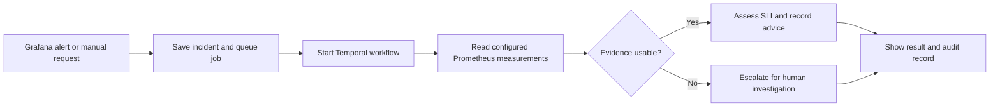
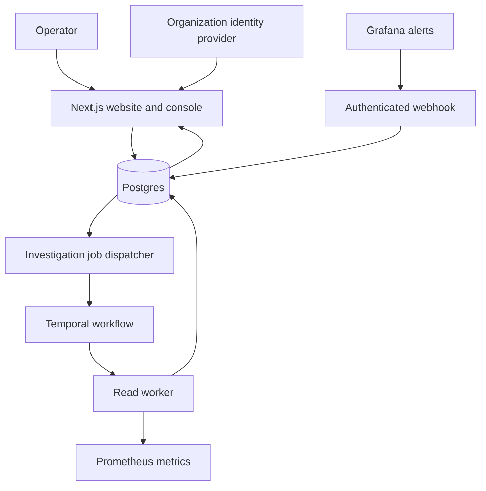

<div align="center">

# Sentinel

### Understand service problems. Collect evidence. Keep people in control.

An agentic Site Reliability Engineering project for AWS services.

**Current stage: working local foundation · Live cloud setup pending · Production actions disabled**

[Overview](#overview) · [Fundamentals](#fundamentals) · [Architecture](#architecture) · [Quick start](#run-the-demo) · [Implementation status](#what-works-today)

</div>

---

## Overview

Imagine an online shopping website becomes slow after a new release. The engineer has to answer several questions:

- Are customers actually affected?
- What changed recently?
- What do the monitoring measurements show?
- What should the team investigate next?
- Is there enough evidence to take action safely?

**Sentinel brings these questions into one reliability workspace.** It receives alerts, runs an investigation, collects measurements and records the result.

The current implementation can collect configured Prometheus measurements and run a durable, read-only investigation. It produces an advisory result or escalates when evidence is unavailable. It **does not automatically repair production services**.

## Contents

| Topic | Reference |
| --- | --- |
| Understand the basic concepts | [Fundamentals](#fundamentals) |
| Follow one investigation | [How it works](#how-an-investigation-works) |
| Understand the components | [Architecture](#architecture) |
| Check implementation progress | [What works today](#what-works-today) |
| Try the project without AWS | [Run the demo](#run-the-demo) |
| Configure the real workspace | [Connect real services](#connect-real-services) |
| Understand the safety rules | [Safety and trust](#safety-and-trust) |
| Read commands and source layout | [Developer reference](#developer-reference) |

Architecture diagrams and expandable reference sections are included below. The interactive website and console run locally.

## Fundamentals

| Term | Definition | Example |
| --- | --- | --- |
| **SRE** — Site Reliability Engineering | Engineering work that keeps a service dependable. | Investigating why a shopping website is failing. |
| **Service** | One application or component with a specific job. | The checkout backend. |
| **AWS** — Amazon Web Services | A cloud platform for running applications and infrastructure. | Hosting the checkout service. |
| **ECS** — Elastic Container Service | An AWS service that runs applications packaged as containers. | Running several copies of the checkout application. |
| **Observability** | Understanding what a system is doing from its recorded signals. | Looking at request failures and response times. |
| **Metric** | A number measured over time. | Failed requests per minute. |
| **Log** | A recorded message about something that happened. | A request failed because a dependency timed out. |
| **Trace** | A record of one request moving through different components. | Browser → checkout → payment service. |
| **Alert** | A notification that a monitoring rule detected a condition. | The failure rate crossed a threshold. |
| **Incident** | A problem the team is investigating or responding to. | Customers cannot complete checkout. |
| **SLI** — Service Level Indicator | A measurement of the experience a service provides. | The percentage of successful requests. |
| **SLO** — Service Level Objective | The target for that measurement over a defined period. | At least 99.9% successful requests. |
| **Error budget** | The amount of failure allowed by an SLO. | A 99.9% request-success target allows 0.1% unsuccessful requests. |
| **Burn rate** | How quickly failures are using the error budget compared with the allowed rate. | A 2% error rate against a 0.1% allowance means 20× burn. |
| **Latency / p99** | Latency is response time. p99 is the value at or below which about 99% of measured response times fall. | A p99 target of 300 milliseconds. |
| **Evidence** | A recorded observation used to support an investigation. | Fresh request counts returned by Prometheus. |
| **Hypothesis** | A possible explanation that still needs evidence. | A recent deployment may have caused the errors. |
| **Severity** | How serious the observed user impact is. | Sustained high error-budget burn is more serious than a dramatic alert title. |
| **Escalation** | Asking a human or another responsible team to investigate. | Telemetry is missing, so Sentinel cannot make a supported assessment. |
| **Playbook** | A predefined procedure for handling a situation. | A future signed procedure to roll back a specific ECS deployment. |
| **Rollback** | Returning an application to a previous version. | Restoring the earlier task definition after a bad release. |
| **Agentic system** | A system that coordinates steps toward a goal instead of only answering one question. | Receive a signal → collect evidence → assess → record the result. |

<details>
<summary><strong>Show a simple SLO and burn-rate calculation</strong></summary>

Suppose the target is **99.9% successful requests**.

```text
Allowed error rate = 100% - 99.9% = 0.1%

For 100,000 requests:
Allowed unsuccessful requests = 100,000 × 0.001 = 100

If the observed error rate is 2%:
Burn rate = 2% ÷ 0.1% = 20×
```

Sentinel checks more than one time window. Its availability policy uses paired windows of **5 minutes / 1 hour** and **30 minutes / 6 hours**. This helps distinguish sustained problems from brief spikes.

A latency breach can also affect severity. The collector rejects zero-traffic, stale or invalid observations rather than reporting them as proof of good health.

</details>

<details>
<summary><strong>Show the difference between an alert, evidence and a conclusion</strong></summary>

- **Alert:** “CRITICAL: checkout is broken.” This is an incoming message, not proof.
- **Evidence:** Request measurements show 2% failures in the relevant windows.
- **Assessment:** The measured error rate indicates user impact.
- **Cause:** A bad deployment is still only a hypothesis until supported by additional evidence.

A recent deployment and an incident occurring together do not automatically prove that the deployment caused the incident.

</details>

## How an investigation works



1. A user starts an investigation, or an authenticated Grafana webhook receives an alert.
2. Sentinel saves the incident and a queued job together in the database.
3. A worker starts a Temporal workflow. Temporal stores the workflow's progress.
4. The read worker queries the service's configured SLI measurements.
5. Sentinel validates the observations and evaluates the SLI severity when usable evidence is available.
6. It records advice or an escalation, then displays the saved result and evidence in the workspace.

**Important distinction:** the demo simulates a richer incident lifecycle with saved scenarios. The current real investigation workflow is read-only and does not yet perform full cause analysis, approvals or rollback.

<details>
<summary><strong>Why use a queue and Temporal?</strong></summary>

A web request should not need to wait for an entire investigation.

- The **outbox** is a database table containing jobs waiting to be dispatched.
- The incident and its job are saved in one **transaction**: they succeed together or fail together.
- **Temporal** keeps workflow history and can retry failed activities.
- A predictable workflow ID prevents a dispatch retry from starting a second copy of the same investigation.
- An **activity** is a step that performs work outside the workflow, such as querying telemetry or saving results.

These mechanisms make the process more reliable when a process stops or a network request fails. They do not guarantee that an external monitoring service will always be available.

</details>

## Architecture



| Component | Its job |
| --- | --- |
| **Website** | Explains Sentinel and provides an interactive investigation-model illustration. |
| **Operator console** | Lets authenticated users manage workspaces, register services and review investigations. |
| **Console APIs** | Handle login, workspace access, SLO settings, webhooks and investigation requests. |
| **Postgres** | Stores identities, memberships, services, incidents, evidence and audit events. |
| **Dispatcher** | Finds queued investigation jobs and starts their workflows. |
| **Temporal** | Coordinates durable workflow execution. |
| **Read worker** | Collects configured evidence and persists the investigation result. |
| **Policy package** | Contains deterministic severity and decision rules. |
| **Separate demo API** | Streams synthetic metrics and replays fixture scenarios. It does not operate real AWS services. |

<details>
<summary><strong>What technologies are used, and why?</strong></summary>

| Technology | Purpose |
| --- | --- |
| TypeScript | Shared types and checks across the application. |
| Next.js 16 + React 19 | Website, console and server routes. |
| Tailwind CSS + Motion + Lucide | Styling, interaction animation and icons. |
| PostgreSQL + node-postgres + Drizzle | Database foundation, transactions and data access tooling. |
| Temporal TypeScript SDK | Durable investigation workflows and workers. |
| Prometheus | Request and latency measurements. |
| OpenID Connect + openid-client | Organization login. |
| SimpleWebAuthn | Passkey enrollment and server verification. |
| Node.js crypto | Hashing, secret generation and signature utilities. |
| AWS SDK | Standalone read-only ECS adapter. |
| Vitest | Unit, database, HTTP and workflow tests. |
| Docker Compose | Local multi-service development configuration. |

The current small standalone API uses Node.js HTTP. Hono, additional workers and several tools from the long-term design are planned; they are not all part of the current runtime.

</details>

## What works today

“Implemented” means code is present. It does not mean every external service has been connected or that production deployment is complete.

| Capability | Current status |
| --- | --- |
| Website and interactive explanation | Implemented; interaction checked in browser. |
| Separate demo workspace and replay runtime | Implemented; fixture routes live under `/demo/...`. |
| Workspace, service and membership APIs | Implemented; database and HTTP tests pass. |
| Database tenant isolation and audit ledger | Implemented; tested with a non-superuser Postgres role. |
| OIDC login flow and stored sessions | Implemented; real organization-provider login still needs setup and verification. |
| Passkey enrollment | Implemented; rejection cases tested. Successful authenticator enrollment remains unverified. |
| Prometheus connection checks and SLI collection | Implemented; provider responses tested using mocks. Live Prometheus connection remains unverified. |
| Grafana webhook ingestion and revocation | Implemented; HTTP tests cover credentials, duplicates and revocation. Live Grafana connection remains unverified. |
| Durable investigation dispatch | Implemented; tested with real Postgres and an ephemeral Temporal test server. |
| ECS and GitHub read adapters | Standalone implementations with mocked tests; not yet integrated into incident collection. |
| Playbook signing and execution-plan hashing | Standalone utilities; not yet an execution-approval system. |
| Production rollback or other automated repair | **Not implemented.** |
| LLM/Bedrock investigation | Planned. Current live assessment uses deterministic rules. |
| Full AWS deployment and remaining SRE modules | Planned or incomplete. |

The connector catalog contains **planned integrations** too. An entry in that catalog is not a working connection.

See [the detailed implementation status](docs/IMPLEMENTATION_STATUS.md) for the full list of limitations and remaining work.

## Run the demo

### Requirements

- Node.js **24 recommended**.
- npm, included with Node.js.
- This repository on your computer.

**AWS credentials, an identity provider and a production database are not needed for the fixture demo.**

Install once from the repository root:

```sh
npm ci
```

Open two terminals in that same folder:

| Terminal | Command | Purpose |
| --- | --- | --- |
| 1 | `npm run dev:console` | Starts the website and console on port **3010**. |
| 2 | `npm run dev:demo-api` | Starts the isolated demo feed on port **8790**. |

Then open:

- [Website](http://localhost:3010)
- [Demo workspace](http://localhost:3010/demo)
- [Real workspace setup](http://localhost:3010/dashboard)

Try **Replay a bad deploy**, **Replay a retry storm**, or **Replay a false alarm**. Open a saved incident to inspect its simulated timeline and policy result.

<details>
<summary><strong>Demo scenarios</strong></summary>

| Scenario | What it teaches |
| --- | --- |
| Bad deployment, advise mode | A proposed action is different from executing an action. |
| Alarm titled CRITICAL, SLI healthy | Alert wording does not determine user impact. |
| Retry storm | A tempting action can still be refused by policy. |
| Access denied after rotation | Permission changes belong to the never-execute list. |
| Two unsuccessful mitigations | The simulated policy stops after two strikes and escalates. |

All of these are fixture scenarios. Even an “act mode” replay is a simulation; it does not change AWS resources.

</details>

<details>
<summary><strong>Command-line usage</strong></summary>

```sh
npm run demo
npm run validate
```

`demo` runs saved incident scenarios through the fixture engine. `validate` prints the connector catalog and configuration requirements; it does not prove that those integrations are connected.

The optional normal API starts separately:

```sh
npm run dev:api
```

It listens on port **8787**, with demo mode disabled. The real workspace APIs are provided by the Next.js console server; the standalone API does not currently serve the persisted production workspace records.

</details>

## Connect real services

This path requires additional infrastructure. It is separate from the no-credentials demo.

1. Configure a database and an OIDC provider.
2. Apply migrations and provision the runtime database role.
3. Sign in and create a workspace.
4. Register a service using its ECS ARN, AWS account and region.
5. Configure Prometheus credentials and the workspace allowed to use them.
6. Save the service's SLO queries.
7. Run Temporal and the read worker.
8. Start an investigation and review its saved evidence.

<details>
<summary><strong>Open the configuration guide</strong></summary>

Copy the environment template **only if you do not already have your own `.env`**:

```sh
cp .env.example .env
```

Root runtime commands load `.env` automatically.

| Setting | Meaning |
| --- | --- |
| `DATABASE_URL` | Connection string for the database used by the process. |
| `OIDC_ISSUER` | Organization identity-provider URL. |
| `OIDC_CLIENT_ID` / `OIDC_CLIENT_SECRET` | Credentials for Sentinel's registered login application. |
| `SENTINEL_PUBLIC_URL` | Exact website origin, without a trailing slash. |
| `PROMETHEUS_URL` / `PROMETHEUS_TOKEN` | Metrics endpoint and optional bearer token. |
| `SENTINEL_CONFIG_WORKSPACE_ID` | The one workspace allowed to use the server-scoped provider credentials. Copy its UUID from the dashboard. |
| `TEMPORAL_ADDRESS` | Address of the Temporal server. |
| `SENTINEL_DATABASE_ADMIN_PASSWORD` | Administrator password for the local durable Compose stack. |
| `SENTINEL_DATABASE_PASSWORD` | Separate runtime-role password for that stack. |

Register the local OIDC callback as:

```text
http://localhost:3010/api/auth/callback
```

Remote deployment requires HTTPS. Use different, URL-safe local database passwords of at least 16 characters. Keep credentials out of Git, logs and screenshots.

For the durable local development stack:

```sh
docker compose -f compose.durable.yml up --build
```

This configuration includes Postgres, Temporal, migrations, console and the read worker. It has been configuration-validated; a full container deployment has not yet been verified. Its Temporal development server is not a production Temporal deployment. Stop an existing console process before starting another on port 3010.

For host processes instead of the container application, configure the database/server addresses, then run:

```sh
npm run db:migrate
npm run db:provision
npm run dev:worker-read
```

Run migrations/provisioning with an administrative database connection. Run the application with the restricted `sentinel_app` role. An existing runtime role keeps its current password during provisioning.

</details>

<details>
<summary><strong>How are the SLO queries configured?</strong></summary>

Provide:

- An availability target as a ratio, such as `0.999`.
- A latency target in milliseconds, such as `300`.
- A good-request count query containing `{window}`.
- A total-request count query containing `{window}`.
- A p99 latency query returning milliseconds.

Sentinel replaces `{window}` with `5m`, `30m`, `1h` and `6h`. Each query must return exactly one series. Query examples depend on your application's actual metric names and labels; blindly copying a query can measure the wrong service.

Per-workspace secret references are not implemented yet. For now, only the explicitly assigned workspace can use the server's Prometheus credentials.

</details>

## Safety and trust

| Rule | Why it matters |
| --- | --- |
| **Advise by default** | An investigation should not silently change production. |
| **Evidence before conclusions** | Missing or stale measurements should not produce false confidence. |
| **Alert titles are untrusted** | “CRITICAL” in a message is not a measurement of customer impact. |
| **Workspace isolation** | One workspace should not read another workspace's records. |
| **Least privilege** | A read worker should have only the access required for its job. |
| **Append-only audit records** | Application users cannot quietly rewrite the recorded history. |
| **Deduplicated delivery** | Repeated webhook delivery should not create repeated copies of the same investigation. |
| **Resolution is verified** | A resolved alert alone is not proof that the original SLI recovered. |

<details>
<summary><strong>Security terminology</strong></summary>

| Term | Meaning |
| --- | --- |
| Authentication | Checking who a user is. |
| Authorization | Checking what that user is allowed to do. |
| OIDC / SSO | Signing in through an organization's identity provider. |
| PKCE | A login protection that binds the authorization code exchange to the login attempt. |
| State and nonce | Random values used to connect a login response to the correct request and resist response replay. |
| Session | A temporary signed-in relationship between the browser and server. |
| Passkey | A public-key credential used through an authenticator, often with device verification. |
| Hash | A fingerprint of data. A matching hash is useful for detecting changes; it does not encrypt the data. |
| Encryption | Protecting data so it can be read only with the appropriate key. |
| Digital signature | A way to verify that data was signed with a particular private key and has not been changed. |
| Row-level security | Database rules that restrict which workspace's rows a connection can access. |
| Idempotency | Retrying an operation without creating another copy of its intended effect. |
| Fail closed | Refusing to proceed when a required safety check cannot be satisfied. |

The audit view checks the returned chain segment. It is **not** a guarantee against a malicious database administrator. Likewise, signing utilities and passkey enrollment alone do not make production execution safe: the complete approval and execution gates are still pending.

</details>

<details>
<summary><strong>What will Sentinel never execute under the design?</strong></summary>

The design's never-execute list includes:

- Deleting or rewriting customer data.
- Changing IAM permissions or identity policies.
- Opening network exposure.
- Spending money through purchases, reservations or quota increases.

These should remain human decisions. The fixture policy tests include refusal cases. The current real worker has no production actuation path at all.

Future permitted rollback will require a signed playbook, an exact execution-plan hash, fresh approval, policy checks and recovery verification. That complete execution path is not implemented yet.

</details>

## Developer reference

<details>
<summary><strong>Open the repository map</strong></summary>

```text
apps/
  console/          Website, operator console and workspace APIs
  api/              Small normal/demo HTTP API
  cli/              Fixture replay and connector catalog commands
  worker-read/      Investigation dispatcher and evidence activities
packages/
  auth/             OIDC sessions and passkey enrollment
  contracts/        Shared TypeScript types
  connectors/       Catalog, Prometheus, Grafana, GitHub and ECS adapters
  db/               Migrations, transactions and audit utilities
  engine/           Fixture incident state machine
  fixtures/         Saved demo scenarios
  policy/           Severity, refusal rules and signature utilities
  workflows/        Temporal read-only investigation workflow
scripts/            Runtime and CI helpers
docs/               Implementation status
```

</details>

<details>
<summary><strong>Open verification commands</strong></summary>

```sh
npm test
npm run typecheck
npm run build -w @sentinel/console
npm audit
```

Some suites are opt-in:

| Setting | Enables |
| --- | --- |
| `TEST_DATABASE_URL` | Integration tests against a dedicated migrated test database. |
| `TEST_TEMPORAL=true` | Ephemeral Temporal-server workflow tests. |
| `TEST_CONSOLE_URL` | Authenticated HTTP tests against an isolated configured console. |

Use a non-superuser test role and a disposable database. Database tests create fixture records; never point them at production. Console HTTP tests insert test sessions directly and do not verify a real OIDC provider.

The GitHub Actions workflow is defined in [verify.yml](.github/workflows/verify.yml). Its remote execution has not yet been verified.

</details>

<details>
<summary><strong>Troubleshooting</strong></summary>

| Symptom | What to check |
| --- | --- |
| Port 3010 is busy | Another console is running. Stop that process or use the existing preview. |
| Demo feed is disconnected | Run `npm run dev:demo-api`; its default port is 8790. |
| Workspace shows setup instructions | Database/OIDC configuration is missing on the console server. |
| Investigation stays queued | Check that Temporal and the read worker are running. |
| Investigation escalates without evidence | Check SLO queries, fresh traffic, Prometheus access and the assigned workspace ID. |
| Passkey enrollment asks for sign-in | Enrollment requires a recent sign-in and a supported browser/authenticator. |
| Database isolation appears ineffective | Check that the runtime role is not a superuser and has no `BYPASSRLS`. |

</details>

## Next steps

The next major work includes real provider verification, per-workspace secret storage, deeper investigation/cause analysis, complete passkey-bound approvals, isolated actuation and safe ECS rollback. Additional SRE modules and integrations follow in later phases.

**Sentinel's guiding principle: measure first, investigate with evidence, and keep production changes under explicit authority.**
