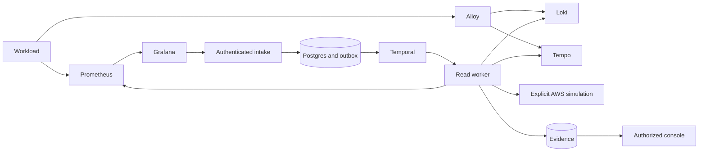

# Sentinel architecture

The existing TypeScript workspaces, Next.js console, PostgreSQL and Temporal remain the control plane. Detailed target contracts and migration ordering live in [PLAN.md](PLAN.md).

## Boundaries

The console validates sessions, workspace membership and mutations. Intake accepts validated signals durably; the outbox dispatcher starts Temporal work. Workflow code schedules activities and must remain deterministic. Activities resolve configuration, read bounded provider responses and persist evidence. PostgreSQL owns tenant relationships and audit records; provider systems own bulk telemetry.

Workspace connector instances, investigation runs, source attempts and immutable evidence are in the schema from migration 0015 onward. A mapped Kubernetes read is an optional ninth source. AWS observations stay simulated until a dedicated sandbox profile is configured. Bulk telemetry stays in Prometheus, Loki and Tempo.

Optional collection runs in batches of four, after Prometheus. Temporal patch branches preserve the old command sequence for replay. The communication worker owns ntfy and Slack delivery through the notification ledger. The read worker records evidence and does not post once connector mode is on. Incident recovery is a separate transition from investigation completion. Simulated evidence cannot satisfy that transition.

Local Compose networking, ports and startup commands are documented in [ENVIRONMENT.md](ENVIRONMENT.md).
