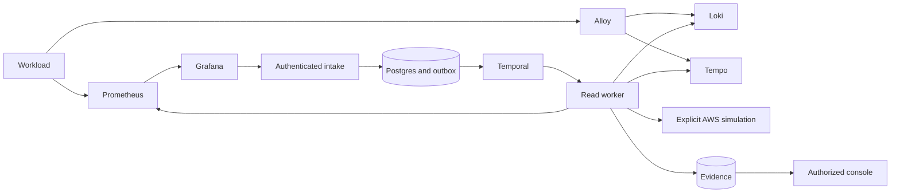

# Sentinel architecture

The existing TypeScript workspaces, Next.js console, PostgreSQL and Temporal remain the control plane. Detailed target contracts and migration ordering live in [PLAN.md](PLAN.md).

## Boundaries

The console validates sessions, workspace membership and mutations. Intake accepts validated signals durably; the outbox dispatcher starts Temporal work. Workflow code schedules activities and must remain deterministic. Activities resolve configuration, read bounded provider responses and persist evidence. PostgreSQL owns tenant relationships and audit records; provider systems own bulk telemetry.

Current source settings are mostly process-global and evidence is unique by incident/source. The approved next data model adds connector instances, investigation runs, source attempts and immutable evidence envelopes through forward migrations. These target capabilities must not be inferred from the current schema.

Optional collection now runs in batches of four, after Prometheus, so ECS correlation can read metrics already stored. Temporal patch branches preserve the old command sequence for replay. Historical replay fixtures remain an acceptance task. Notifications currently remain in the read activity set with delivery-failure isolation; the separate communication worker and delivery ledger remain pending.

Local Compose networking, ports and startup commands are documented in [ENVIRONMENT.md](ENVIRONMENT.md).
