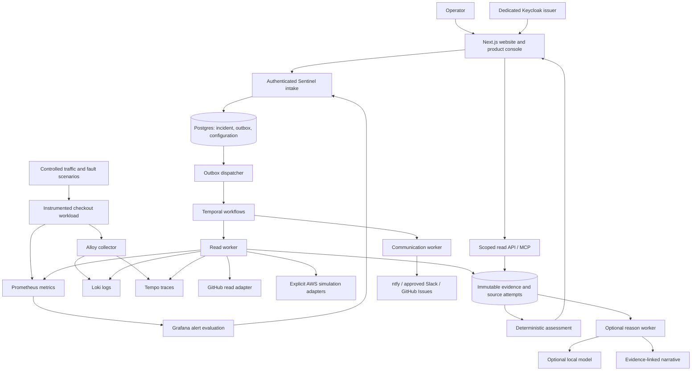

# Sentinel master implementation plan

The active execution plan is [PLAN-COMPLETION.md](PLAN-COMPLETION.md). This file remains the 2026-11-16 master plan. Measured results stay in [IMPLEMENTATION_STATUS.md](IMPLEMENTATION_STATUS.md).

**Goal:** Turn the current Sentinel repository into one coherent SRE product with a redesigned website and operator console, real local observability, durable investigations, useful free integrations, explicit AWS simulation, and a reviewed path to future live AWS operation.

**Baseline:** GitHub and the primary local checkout are both on `main` at `3ebe3b6`. The ZIP showcase, offline HTML, approval foundation, source-specific evidence work and Cursor’s latest integration changes are already pushed and merged. The current `main` CI run passed.

**Fresh checks performed while preparing this plan:** 57 tests passed, 17 integration tests skipped; TypeScript check passed. These results do not establish that all Docker services, browser authentication or every live connector work.

**Execution status:** Approved for implementation on 2026-11-16. This file replaces the older AWS-first plan, preserved in `PLAN-AWS-FIRST-ARCHIVE.md`. Measured progress and outstanding acceptance checks are recorded in `IMPLEMENTATION_STATUS.md`.

No timeline is imposed. Work is ordered by dependency and verification. A later milestone starts when its prerequisites pass, rather than after an arbitrary number of days.

---

## 1. Product outcome and definition of done

Sentinel should let an operator:

1. Sign in through a real identity provider.
2. Create a workspace and register a service.
3. Configure monitoring connections with scoped access.
4. Receive an actual Grafana alert or request an investigation.
5. Follow the investigation through its persisted workflow.
6. Inspect actual measurements, logs, traces and recent changes.
7. Distinguish measured facts, missing information and hypotheses.
8. Receive an authorized notification.
9. Record human actions, verify recovery and generate a postmortem.
10. Review service reliability, outstanding actions and operational reports.

AWS credentials are not required for the local product. AWS observations remain explicitly simulated until an authorized sandbox is configured.

### Completion has three distinct meanings

| Completion level | Required evidence |
|---|---|
| **Working local product** | Real workload traffic, monitoring, alerts, identity, storage, investigation, notifications and redesigned UI verified together |
| **Connected provider capability** | Actual configured provider returns meaningful records through Sentinel, with permissions, failure handling and provenance verified |
| **Live AWS capability** | The team repeats the relevant behavior against an authorized AWS sandbox; simulation tests cannot satisfy this level |

A catalog entry, successful build, readiness endpoint or simulated scenario cannot establish a connected provider capability.

### Essential acceptance scenario

A controlled failure in a running checkout service must:

- Produce actual failing HTTP requests.
- Change Prometheus measurements.
- Produce useful logs and traces.
- Trigger a Grafana alert.
- Reach Sentinel’s authenticated webhook.
- Create or join the appropriate incident.
- Start a Temporal investigation.
- Store independently labelled source results.
- Display the incident in the real workspace.
- Send an authorized local notification.
- Preserve the investigation across process restarts.
- Show recovery only after actual SLI verification.

The same incident may contain simulated ECS context, but simulated context must not become proof of the real failure’s cause.

---

## 2. Scope, constraints and requirement ledger

The original product remains the long-term scope. This plan distinguishes genuinely connected behavior from simulation and unavailable integrations instead of silently removing requirements.

The following identifiers are new planning identifiers because the repository has no established PRD requirement IDs.

| ID | Requirement |
|---|---|
| R01 | Preserve merged work, ZIP assets and meaningful existing functionality |
| R02 | Reproducible local development and operational configuration |
| R03 | Real authentication, workspace membership and tenant isolation |
| R04 | Workspace-scoped connector configuration and secret references |
| R05 | Actual metrics, logs, traces and alert delivery |
| R06 | Durable, retry-safe investigation and partial results |
| R07 | Explicit evidence provenance, freshness and coverage |
| R08 | Useful source-control, health-check and communication integrations |
| R09 | Redesigned marketing website and operator console |
| R10 | Incident lifecycle, collaboration, recovery and postmortems |
| R11 | SLO lifecycle, alert hygiene and release/change visibility |
| R12 | Optional evidence-grounded AI assistance |
| R13 | Operational modules: capacity, cost, posture, DR, certificates, drift and lifecycle |
| R14 | Runbooks, knowledge, reporting, toil and resilience exercises |
| R15 | Signed authority and a separately reviewed future action path |
| R16 | Tests, CI, observability, documentation and reproducible handoff |

### Confirmed constraints

- Keep TypeScript, Next.js, PostgreSQL and Temporal.
- Keep real workspace and explicit demo routes.
- Do not use company AWS profiles or a company identity provider.
- Do not automatically substitute mocked responses when a live provider fails.
- Keep production infrastructure actions disabled during the local-product work.
- Use real free/self-hosted providers wherever feasible.
- Use clearly simulated AWS observations until credentials arrive.
- Preserve Harshit’s merged work.
- Keep credentials outside Git and chat.
- Use the selected **Operational premium** frontend direction.
- Retain a usable light theme and reduced-motion behavior.
- Do not install every available library or invoke every skill merely because it exists.

### Hardware constraint discovered

The laptop has 16 GB of physical memory. Docker is available.

The full observability stack, application services, build processes and local AI model must therefore use optional profiles and measured resource limits. Running every possible service and model simultaneously is not the default.

### Explicit exclusions from the initial local completion gate

These remain later capabilities with explicit status:

- Real AWS billing, IAM, ECS mutation and disaster recovery.
- Paid provider features without access.
- Organization-wide SCIM/SAML provisioning.
- Multi-region production availability.
- Actual EKS behavior verified only through a local Kubernetes cluster.
- Production-grade Temporal deployment established merely by running `start-dev`.
- Human response guarantees or paid SMS/voice delivery.
- Autonomous infrastructure repair based on model output.

---

## 3. Current implementation: retain, repair or extend

### Work already merged

The repository contains:

- ZIP showcase and standalone offline demo.
- Real workspace APIs.
- PostgreSQL migrations through `0014_evidence_sources.sql`.
- OIDC session foundation.
- Passkey and plan-bound approval foundation.
- Temporal dispatcher and read workflow.
- Prometheus, ECS, Loki, Tempo and GitHub adapter code.
- Simulated CloudWatch, cost and DR observations.
- ntfy publishing helper.
- Docker observability configuration.
- Local workload server.
- Initial real incident detail view.
- A small read-tool package under `packages/mcp-read`.

These are starting points, not automatically completed product features.

### Confirmed gaps that must drive implementation

| Existing behavior | Required correction |
|---|---|
| Workload latency is a constant gauge | Measure actual request latency using a histogram |
| Workload does not emit actual traces | Instrument requests and export OTLP traces |
| Workload process-start metric is absent | Expose lifecycle information and calculate coverage from actual samples |
| Worker uses workload uptime as a coverage proxy | Verify sample coverage per SLI window |
| Local Keycloak uses HTTP; auth constructor requires HTTPS | Add a narrowly scoped local-development configuration or provide local TLS |
| Keycloak callback is tied to test port `3023` | Standardize public development URL and generated realm configuration |
| Grafana contact point targets `3023` | Route to the actual console service, with environment-derived endpoint and secret |
| Contact point alone does not establish a complete alert pipeline | Provision a working evaluator and notification routing, then verify actual delivery |
| Source activities are sequential | Use independent source execution with bounded concurrency |
| Optional activity errors can stop the workflow | Persist per-source failures and continue when safe |
| Notification runs inside the read workflow’s activity set | Move external communication to a separately authorized worker |
| Evidence is unique by incident/source | Introduce investigation runs and attempts without rewriting evidence |
| Provider settings are mostly process-global | Introduce workspace-scoped connector instances |
| Incident detail fetches a list and searches it | Add a dedicated authorized incident-detail endpoint |
| Real incident list is a placeholder | Implement actual pagination, filtering and navigation |
| Shell hides most real navigation | Replace with a real product navigation structure |
| MCP package is a function wrapper | Implement actual protocol transport and authentication before calling it a working MCP server |
| Historical migration assigns `live` provenance broadly | Preserve history while distinguishing provenance from verification status |
| Existing audit history is presented as integrity evidence | Verify chain segments and clearly state verification limits |

---

## 4. Architecture



### Component ownership

| Component | Owns | Must not own |
|---|---|---|
| Console | Interaction, authenticated routes, workspace selection | Provider credentials in browser |
| Intake | Validation, authentication, durable acceptance | Full investigation inside HTTP request |
| PostgreSQL | Product records, relationships, configuration, outbox | Raw long-term telemetry storage |
| Temporal | Durable ordering, timers, retries and state transitions | Arbitrary network calls directly in workflow code |
| Read worker | Bounded provider reads and evidence persistence | Cloud mutations or communication posting |
| Assessment engine | Deterministic conclusions and evidence references | Invented causal certainty |
| Communication worker | Explicitly authorized external messages | Infrastructure changes |
| Reason worker | Optional summarization and specialist orchestration | Approval authority or write tools |
| Simulation adapters | Deterministic fictional provider observations | Successful live authentication claims |
| Future act worker | Reviewed executable playbooks | General-purpose shell, unrestricted SDK tools |

### Data storage principles

- Provider systems keep bulk metrics, logs and traces.
- Sentinel stores bounded evidence snapshots and source links.
- Incident records are mutable aggregates with concurrency control.
- Evidence, decisions, approvals and audit events are append-only.
- New observations create new records instead of replacing history.
- Configuration versions are recorded with investigation runs.
- Secret values are resolved server-side from opaque references.
- Simulation is recorded on individual observations and derived conclusions.

---

## 5. Technology choices and dependency policy

### Retain

- Next.js App Router.
- React.
- TypeScript.
- Tailwind CSS.
- Motion.
- Lucide.
- React Flow.
- cmdk.
- Sonner.
- PostgreSQL and existing `pg` access patterns.
- Temporal.
- Vitest.
- Existing OIDC and WebAuthn packages.

### Add for specific responsibilities

| Dependency | Purpose | Boundary |
|---|---|---|
| Zod | Runtime API/configuration/provider validation | Shared schemas without importing server secrets |
| TanStack Query v5 | Client server-state fetching, retries and invalidation | No replacement for database or durable workflow state |
| TanStack Table v8 | Incident, service, evidence and audit tables | Server handles pagination/filter authorization |
| Base UI with official shadcn components | Accessible dialogs, menus, forms, tabs and drawers | One primitive system; avoid mixing duplicate component libraries |
| React Hook Form | Connector, SLO and settings forms | Server validates again |
| Recharts | Summary charts | Accessible table alternative |
| uPlot | Dense incident timeseries | Dynamically loaded; dedicated adapter |
| Playwright | Browser acceptance tests | Test identity and dedicated disposable environment |
| axe integration | Automated accessibility checks | Does not replace keyboard/manual review |
| Storybook | Shared component states | No production runtime dependency |
| OpenTelemetry SDK/instrumentation | Actual traces and Sentinel self-observability | Pin compatible versions together |
| Prometheus client library | Actual workload counters/histograms | Keep metrics bounded in label cardinality |
| MCP SDK | Actual read-only MCP transport | Scoped principal required |

Use current official documentation during installation, record exact resolved versions in the lockfile, and run compatibility checks. Do not invent future version numbers in this plan.

Official shadcn Next.js integration, TanStack Query server-state behavior and Motion scroll hooks support these responsibilities. They do not prove that any arbitrary combination is compatible before testing. [shadcn](https://ui.shadcn.com/docs/installation/next), [TanStack Query](https://tanstack.com/query/latest/docs/framework/react/overview), [Motion](https://motion.dev/docs/react-use-scroll)

### Do not add as mandatory dependencies

- A second application framework.
- Redis or Kafka beside the existing outbox without a demonstrated need.
- SigNoz alongside the chosen Grafana telemetry stack.
- LocalStack for the current observation simulation.
- A vector database before retrieval requirements justify it.
- Multiple overlapping state-management libraries.
- A Kubernetes deployment requirement for local development.
- Every installed skill as a mandatory execution step.

---

## 6. Contracts, state and correctness rules

### 6.1 Shared contract layout

Extend `packages/contracts` into focused modules while preserving its existing public exports.

Proposed files:

```text
packages/contracts/src/
  index.ts
  ids.ts
  errors.ts
  pagination.ts
  connector.ts
  evidence.ts
  investigation.ts
  incident.ts
  slo.ts
  change.ts
  notification.ts
  report.ts
  policy.ts
  schemas/
    connector.ts
    investigation.ts
    incident.ts
    slo.ts
```

The existing demo contracts remain available through a compatibility export until all consumers migrate.

### 6.2 Connector instance

A connector instance represents a configured connection belonging to one workspace.

Required concepts:

```ts
type ConnectorMode = "live" | "simulated" | "off";

interface ConnectorInstance {
  id: string;
  workspaceId: string;
  provider: string;
  mode: ConnectorMode;
  enabled: boolean;
  configVersion: number;
  secretRef?: string;
}
```

Provider-specific configuration uses discriminated runtime schemas. Do not accept arbitrary JSON as executable connector configuration.

Health status must include:

- Last attempt.
- Last successful authenticated operation.
- Capability tested.
- Redacted failure category.
- Configuration version.
- Whether data was actually returned.

“Configured,” “reachable” and “verified read” are separate states.

### 6.3 Evidence envelope

Each observation must carry:

- Workspace, service, incident and run identifiers.
- Connector instance and capability.
- Source mode.
- Observed timestamp.
- Collection timestamp.
- Query time range.
- Configuration version.
- Outcome.
- Bounded payload or artifact reference.
- Content hash.
- Redaction metadata.
- Provider source link when available.

Use separate concepts for:

- **Provenance:** live, simulated or legacy-unknown.
- **Outcome:** success, empty, stale, unavailable, not-configured or insufficient-coverage.
- **Authority:** whether evidence is eligible for a specific decision.

A live HTTP response is not automatically usable evidence. A successful query with zero matching logs is not the same as a failed provider.

### 6.4 Investigation runs and attempts

An incident may have multiple investigation runs.

Each run records:

- Trigger.
- Requested window.
- Configuration snapshot.
- Required and optional sources.
- Start/end timestamps.
- Source outcomes.
- Aggregate result.

Each source may have multiple attempts. A persisted successful attempt is reused on activity retry; an intentional refresh creates another run or attempt.

Existing incident/source uniqueness must not prevent later evidence collection.

### 6.5 Investigation versus incident state

Keep these separate.

**Investigation status:**

```text
queued → running → completed
                 → partial
                 → failed
                 → cancelled
```

**Incident lifecycle:**

```text
declared → investigating → advised/escalated
        → monitoring → resolved → postmortem
```

Rules:

- A completed investigation does not mean the service recovered.
- Missing required SLI evidence escalates.
- Optional source failure produces a visible gap.
- A notification failure does not change a completed investigation into a failed investigation.
- Resolution requires fresh measured recovery across the configured window.
- Simulated observations cannot resolve a live incident.
- Human notes/actions remain attributable and audited.

### 6.6 Severity and coverage

Preserve existing burn-rate thresholds while improving input qualification.

For each relevant window, record:

- Expected sample interval.
- Observed valid samples.
- Earliest/latest valid timestamps.
- Gaps.
- Coverage ratio.
- Whether the rule’s minimum coverage is satisfied.

Default coverage policy for specification:

- Required windows need at least 80% valid expected samples.
- The first and last portions of the window must be represented.
- Large gaps invalidate coverage even if duplicated samples inflate the count.
- Zero traffic is unknown for request-success assessment.
- The latency measurement must declare its units.
- Counter resets must be handled by the query expression.

Short-window measured impact may be reported during warm-up, but a six-hour burn conclusion cannot be asserted from twenty minutes of samples.

### 6.7 Derived conclusions

Every conclusion contains:

- Supporting evidence IDs.
- Contradicting evidence IDs where present.
- Missing evidence.
- Explanation.
- Confidence category.
- Provenance summary.
- Rule/model version.

A conclusion referencing simulated evidence must retain that fact in the UI, API, notification and export.

### 6.8 API behavior

Preserve existing API routes while introducing the missing resources.

| Resource | Behavior |
|---|---|
| `GET /api/workspaces/:workspaceId/incidents` | Paginated list with validated filters |
| `POST /api/workspaces/:workspaceId/incidents` | Authorized declaration with idempotency support |
| `GET /api/workspaces/:workspaceId/incidents/:incidentId` | Dedicated detail resource |
| `POST .../incidents/:incidentId/investigations` | Start another investigation run |
| `GET .../investigations/:runId` | Run and source-attempt details |
| `POST .../incidents/:incidentId/notes` | Attributed operator note |
| `POST .../incidents/:incidentId/actions` | Record a human action; not an infrastructure executor |
| `POST .../incidents/:incidentId/transitions` | Validated lifecycle transition |
| `GET/POST .../connectors` | List/create scoped connector instances |
| `PATCH .../connectors/:connectorId` | Configuration change with version check |
| `POST .../connectors/:connectorId/test` | Bounded server-side connection test |
| `GET .../services/:serviceId/slos` | Versioned SLO definitions and status |
| `GET .../changes` | Paginated normalized changes |
| `GET .../reports/:reportId` | Authorized persisted report |
| `GET .../events` | Workspace-scoped updates |
| `GET .../audit` | Paginated audit and verification result |

Error behavior:

- `400`: invalid request.
- `401`: authentication required.
- `403`: known membership lacks an operation permission.
- `404`: inaccessible workspace/resource.
- `409`: stale configuration or invalid transition.
- `422`: valid syntax but incompatible provider configuration.
- `429`: rate limit.
- `503`: required service unavailable.

Mutation requests require origin/CSRF protection as appropriate, authorization and an audited actor. Long-running work returns `202` with a job/run identifier.

### 6.9 Events and updates

Introduce a workspace event sequence.

- Event records are persisted with relevant product changes.
- SSE resumes with a cursor.
- The API rechecks membership on connection/reconnection.
- Lost events trigger bounded refetch.
- Polling remains the supported fallback.
- Never share a global unauthenticated event stream across workspaces.

### 6.10 Retry and notification safety

- Retry transient reads with bounded backoff.
- Do not retry invalid configuration or denied credentials indefinitely.
- Persist source failures after retries are exhausted.
- Record an outgoing notification before sending.
- Use provider idempotency keys when supported.
- Mark ambiguous timeouts explicitly.
- Do not promise exactly-once delivery for a provider lacking that capability.

---

## 7. Database evolution

Do not rewrite already-merged migration files. Create forward migrations after inspecting the latest migration number.

The following names are proposed; renumber if another migration lands first.

| Proposed migration | Content |
|---|---|
| `0015_connector_instances.sql` | Connector instances, scoped bindings, health attempts and configuration versions |
| `0016_investigation_runs.sql` | Runs, source attempts, immutable evidence envelopes and legacy relationships |
| `0017_incident_lifecycle.sql` | Incident events, notes, roles, state version and semantic grouping |
| `0018_notification_deliveries.sql` | Outgoing communication ledger and delivery attempts |
| `0019_slo_versions_changes.sql` | SLO versions, measurements, change records and watch state |
| `0020_postmortems_reports.sql` | Postmortems, action items, reports and publication records |
| `0021_operations_findings.sql` | Capability-specific findings with provider references |
| `0022_knowledge_reasoning.sql` | Runbook versions, narrative runs and evaluation references |
| `0023_playbook_authority.sql` | Signed registry, revocations and action authorization records |
| `0024_workspace_events.sql` | Ordered workspace events and resumable update support |

Every new workspace-owned table requires:

- Explicit workspace relationship.
- Tenant RLS.
- Composite foreign keys where resources must belong to the same workspace/service.
- Least-privilege runtime grants.
- Suitable list/detail indexes.
- Migration tests.
- Cross-workspace negative tests.

Legacy data is preserved. Existing records must not be retrospectively certified as live-verified merely because a migration labels them.

Do not delete the old evidence tables in the same change that introduces their replacement. Keep compatibility reads until backfill and comparison tests pass.

---

## 8. Ordered milestones and tasks

Each task follows this execution loop:

1. Inspect the current extension point.
2. Add a meaningful failing test where behavior warrants it.
3. Implement the smallest complete behavior.
4. Run focused verification.
5. Run the milestone acceptance scenario.
6. Commit a reviewable change.
7. Update measured implementation status.

### Milestone 0 — Establish the actual baseline and organize delivery

#### M0.1 — Reconcile Git and remove stale assumptions

**Requirements:** R01, R16.

**Existing files:** `docs/PLAN.md`, `docs/RESEARCH.md`, `docs/IMPLEMENTATION_STATUS.md`, handoff documentation.

**Work:**

- Record current main SHA and merged ZIP/source commits.
- Mark older “uncommitted local work” descriptions as historical.
- Identify `/tmp/sentinel-showcase-publish` as a stale review worktree, not the publishing source.
- Review any unique changes there before removing it during execution.
- Do not publish a branch that duplicates already-merged showcase commits.
- Save this approved plan as the replacement master plan.
- Create a requirement/status ledger.

**New documents:**

```text
docs/PRD.md
docs/ARCHITECTURE.md
docs/REQUIREMENTS-MATRIX.md
docs/DECISIONS.md
docs/ENVIRONMENT.md
```

**Verification:** Git status and remote SHA comparison; every claimed existing capability points to current code and measured evidence.

#### M0.2 — Establish a repeatable baseline check

**Requirements:** R02, R16.

**Modify:** root scripts, CI workflow, status documentation.

**Work:**

- Separate fast unit checks from integration acceptance.
- Add standalone showcase typecheck/build to CI.
- Record optional suites as skipped when prerequisites are absent.
- Add reproducible script output for checks and selected environment.
- Keep test credentials restricted to disposable local/CI services.

**Commands already available:**

```sh
npm ci
npm test
npm run typecheck
npm run build:showcase
npm run build -w @sentinel/console
npm audit --audit-level=moderate
```

**Expected result:** A clean checkout can run documented checks without depending on files outside Git.

#### M0.3 — Record the frontend contract

**Requirements:** R09.

**New:** `docs/UI-SPEC.md`.

**Work:** Lock the selected design direction, tokens, navigation, screen states, chart conventions, motion rules and accessibility requirements described in section 10.

**Expected result:** Implementation can proceed without choosing a new visual style on every page.

---

### Milestone 1 — Make local infrastructure and telemetry genuinely work

#### M1.1 — Consolidate Compose connectivity and persistence

**Requirements:** R02, R05, R16.

**Modify:**

```text
compose.durable.yml
compose.observe.yml
Dockerfile
ops/loki.yaml
ops/tempo.yaml
ops/alloy.alloy
```

**New:**

```text
compose.local.yml
scripts/dev/doctor.mjs
scripts/dev/prepare.mjs
scripts/dev/wait.mjs
```

**Work:**

- Provide one documented local startup entry point.
- Use one explicit project/network relationship for console, worker and providers.
- Use Docker service names inside containers.
- Keep laptop ports bound to loopback.
- Mount the intended Loki configuration; the existing file is currently not used by its Compose service.
- Add durable volumes for relevant local state.
- Define readiness checks and bounded startup waits.
- Add optional `reasoning` and `kubernetes` profiles.
- Validate container image availability and configuration before changing version pins.

**Expected result:** Containers can resolve intended provider names, and a restart preserves product data.

#### M1.2 — Replace the workload’s constant measurements

**Requirements:** R05, R07.

**Modify:** `apps/workload/server.mjs`.

**New:**

```text
apps/workload/package.json
apps/workload/src/server.ts
apps/workload/src/metrics.ts
apps/workload/src/tracing.ts
apps/workload/src/faults.ts
apps/workload/src/server.test.ts
```

**Work:**

- Preserve a compatibility startup entry while migrating to typed modules.
- Measure request totals, successful requests and latency histograms.
- Exclude telemetry/readiness requests from business SLIs.
- Export process-start information.
- Generate trace and request IDs.
- Write structured logs with trace correlation.
- Provide explicitly local-only controls for error rate and latency.
- Keep fault controls unavailable in production deployment mode.

**Assertions:**

- `/fail` produces an actual error and increments the correct counter.
- Delayed requests affect actual histogram buckets.
- `/metrics` does not improve the apparent business success rate.
- Trace IDs link a failed request to its log entry.

#### M1.3 — Add reproducible traffic scenarios

**Requirements:** R05, R16.

**New:**

```text
scripts/scenarios/traffic.mjs
scripts/scenarios/degradation.mjs
scripts/scenarios/recovery.mjs
scripts/scenarios/manifest.ts
```

**Work:** Produce healthy traffic, controlled error bursts and latency degradation against the local workload with explicit target allowlisting.

**Expected result:** A repeated scenario produces measurable provider changes without fabricated Prometheus samples.

#### M1.4 — Complete logs and traces ingestion

**Requirements:** R05.

**Modify:** Alloy, Loki and Tempo configurations.

**New tests:** `tests/live/telemetry.live.test.ts`.

**Work:**

- Match Loki labels to Sentinel’s service query.
- Bind OTLP receivers to the intended container interface.
- Forward actual workload traces.
- Set local retention and payload limits.
- Persist necessary offsets/state.
- Verify a trace search followed by trace retrieval.
- Distinguish empty search from unavailable backend.

**Acceptance:** A known request ID is visible in actual Loki logs and its trace is retrievable from Tempo.

#### M1.5 — Fix SLO mappings and coverage

**Requirements:** R05, R07, R11.

**Modify:**

```text
packages/connectors/src/slo.ts
packages/connectors/src/slo.test.ts
packages/policy/src/severity.ts
ops/prometheus.yml
ops/prometheus-rules.yml
```

**New:**

```text
packages/connectors/src/coverage.ts
packages/connectors/src/coverage.test.ts
ops/slos/checkout.yaml
```

**Work:**

- Use real counters and histogram queries.
- Convert seconds to milliseconds where necessary.
- Calculate coverage per required window.
- Remove reliance on workload uptime as proof of continuous collection.
- Model warm-up, counter resets, scrape gaps and zero traffic.
- Preserve current severity thresholds only when the qualifying inputs exist.

**Acceptance:** A fresh twenty-minute deployment cannot claim verified six-hour coverage.

#### M1.6 — Complete actual Grafana alert delivery

**Requirements:** R05, R06.

**Modify:**

```text
ops/grafana/provisioning/alerting/contact-points.yml
ops/grafana/provisioning/datasources/datasources.yml
compose.observe.yml
```

**New:**

```text
ops/grafana/provisioning/alerting/rules.yml
ops/grafana/provisioning/alerting/policies.yml
tests/live/grafana-webhook.live.test.ts
```

**Work:**

- Provision the evaluator and route it to Sentinel.
- Pass endpoint ID and secret into Grafana’s container environment.
- Use the actual application URL.
- Verify the pinned Grafana version’s working custom-header setting.
- Avoid creating parallel Prometheus/Grafana incident sources for the same rule without grouping.
- Preserve resolved notifications as signals, not automatic proof of recovery.

**Acceptance:** Actual alert delivery creates an incident and Temporal run; duplicate delivery does not create another copy.

#### M1.7 — Make real local OIDC login work

**Requirements:** R03.

**Modify:** `packages/auth`, console auth configuration and Keycloak import configuration.

**New:**

```text
scripts/dev/prepare-keycloak.mjs
tests/browser/auth.spec.ts
tests/browser/passkeys.spec.ts
```

**Work:**

- Use one canonical local browser origin.
- Generate local client configuration and secret references.
- Remove reusable committed operator credentials.
- Support local HTTP only behind an explicit development-only flag and exact loopback issuer restriction, including the OIDC library’s required local HTTP option.
- Require HTTPS for nonlocal deployment.
- Verify browser and server discovery see the same issuer.
- Preserve state, nonce, PKCE and one-use login transactions.
- Add virtual-authenticator browser tests and retain a manual hardware-passkey check.

**Acceptance:** Actual login, logout, expired-session rejection and cross-workspace denial work.

**Milestone gate:** A real local alert reaches a persisted investigation under an authenticated workspace. All infrastructure tests record actual provider URLs/versions and results.

---

### Milestone 2 — Complete durable investigations, connector ownership and evidence

#### M2.1 — Add connector-instance persistence

**Requirements:** R04, R08.

**Modify:** database migrations, provisioner and connector exports.

**New:**

```text
packages/db/src/repositories/connectors.ts
packages/connectors/src/registry.ts
packages/connectors/src/config.ts
packages/connectors/src/secrets.ts
packages/connectors/src/config.test.ts
packages/connectors/src/secrets.test.ts
```

**Work:**

- Implement workspace-scoped instances and service bindings.
- Separate public configuration from secret references.
- Record configuration versions.
- Allow explicit live/simulated/off selection.
- Migrate current process-global configuration into a local bootstrap instance without bypassing workspace ownership.

**Acceptance:** Two workspaces cannot read, test or resolve each other’s connector references.

#### M2.2 — Centralize bounded provider HTTP behavior

**Requirements:** R04, R05, R16.

**Modify:** existing egress, Prometheus, Loki, Tempo, GitHub and ntfy clients.

**New:**

```text
packages/connectors/src/http.ts
packages/connectors/src/errors.ts
packages/connectors/src/redaction.ts
packages/connectors/src/http.test.ts
```

**Work:**

- Validate endpoint scheme, host and allowed ports.
- Reject embedded credentials and redirects.
- Apply response-size limits before JSON parsing.
- Validate provider response shapes.
- Enforce timeout and pagination budgets.
- Support provider tokens through secret resolution.
- Restrict local/private addresses to explicitly approved local endpoints.
- Prevent configured paths and DNS behavior from bypassing egress policy.
- Redact errors and evidence.

**Acceptance:** Oversized responses, malicious redirects and unauthorized internal endpoints are rejected without leaking tokens.

#### M2.3 — Introduce run/attempt evidence persistence

**Requirements:** R06, R07.

**New:**

```text
packages/db/src/repositories/investigations.ts
packages/db/src/repositories/evidence.ts
packages/db/src/repositories/incidents.ts
packages/db/src/evidence.test.ts
```

**Work:**

- Implement the run/attempt model.
- Preserve legacy evidence references.
- Add retry keys per run/source/attempt.
- Store source outcome and evidence transactionally with relevant audit records.
- Restore service/configuration consistency checks before accepting observations.
- Record collection and observed timestamps separately.

**Acceptance:** Restarting an activity after persistence does not duplicate evidence, and a later investigation can collect fresh evidence.

#### M2.4 — Split the read worker into focused modules

**Requirements:** R06.

**Modify:** `apps/worker-read/src/activities.ts`, workflow definitions and worker registration.

**New:**

```text
apps/worker-read/src/activities/context.ts
apps/worker-read/src/activities/prometheus.ts
apps/worker-read/src/activities/loki.ts
apps/worker-read/src/activities/tempo.ts
apps/worker-read/src/activities/github.ts
apps/worker-read/src/activities/aws.ts
apps/worker-read/src/activities/persist.ts
apps/worker-read/src/activities/finalize.ts
```

**Work:**

- Resolve authorized context and connector configuration once per run.
- Execute independent source reads with a concurrency limit of four.
- Keep transient retries bounded.
- Catch source exhaustion at the workflow boundary.
- Continue optional sources after another source fails.
- Persist final result even when optional reads fail.
- Remove notification posting from the read worker.
- Version workflow changes safely for any existing histories.

**Acceptance:** A failed Tempo read cannot prevent valid Prometheus and Loki evidence from appearing.

#### M2.5 — Implement provenance-aware assessment

**Requirements:** R07, R12, R15.

**New:**

```text
packages/engine/src/assessment.ts
packages/engine/src/provenance.ts
packages/engine/src/assessment.test.ts
packages/engine/src/provenance.test.ts
```

**Work:**

- Assess qualified live SLI evidence independently.
- Attach causal candidates only to supporting observations.
- Propagate simulation into derived claims.
- Represent unknown and contradicted hypotheses.
- Prevent simulated evidence from satisfying recovery or executable authority.
- Preserve the current deployment correlator as one contributor.

**Acceptance:** Real metrics plus simulated ECS produce a real impact assessment and a separately labelled simulated deployment lead.

#### M2.6 — Add semantic incident grouping

**Requirements:** R06, R10, R11.

**Modify:** Grafana normalization, intake route and incident repository.

**New:**

```text
packages/engine/src/incident-grouping.ts
packages/engine/src/incident-grouping.test.ts
packages/workflows/src/intake.ts
```

**Work:**

- Retain transport delivery deduplication.
- Group active incidents by workspace, service, SLI and configured window.
- Preserve every received signal.
- Handle concurrent first alerts transactionally.
- Do not merge unrelated services merely because titles match.
- Record links rather than deleting duplicate-origin evidence.

**Acceptance:** Concurrent repeat notifications join one appropriate active incident.

#### M2.7 — Add dedicated query APIs

**Requirements:** R06, R09.

**Modify:** existing incident route and console server libraries.

**New API resources:** detail, runs, evidence, notes and transitions from section 6.

**Work:** Replace list-and-find detail loading; add bounded pagination and explicit authorization.

**Acceptance:** An incident outside the first list page still has an accessible authorized detail page.

#### M2.8 — Add workspace updates

**Requirements:** R06, R09.

**New:**

```text
packages/db/src/repositories/events.ts
apps/console/lib/events.ts
apps/console/app/api/workspaces/[workspaceId]/events/route.ts
```

**Work:** Persist sequence, implement SSE replay and polling fallback, invalidate relevant client queries.

**Acceptance:** Reconnection after missed events catches up without cross-workspace leakage.

#### M2.9 — Complete simulation scenarios

**Requirements:** R01, R07, R13.

**Modify:** existing ECS/CloudWatch/cost/DR simulation adapters and showcase model.

**New:**

```text
packages/fixtures/src/aws-scenarios.ts
packages/fixtures/src/scenario-manifest.ts
packages/connectors/src/simulation.test.ts
```

**Work:**

- Select scenarios explicitly.
- Use fictional identifiers.
- Keep scenario/run correlation.
- Include unavailable, stale and contradictory observations.
- Reject real resource identifiers in simulation mode.
- Validate browser-persisted showcase state before use.
- Handle malformed or inconsistent history without crashing.

**Acceptance:** No simulation path invokes AWS or silently claims authenticated access.

**Milestone gate:** Durable run/attempt evidence, partial failures, retry safety, provenance and grouping pass database/Temporal/API tests.

---

### Milestone 3 — Redesign the complete product experience

#### M3.1 — Build a shared design system

**Requirements:** R09.

**New:**

```text
apps/console/styles/tokens.css
apps/console/styles/themes.css
apps/console/components/ui/
apps/console/components/providers.tsx
apps/console/lib/cn.ts
apps/console/components.json
```

**Modify:** global CSS and root layout.

**Work:**

- Implement graphite/dark and light themes.
- Use restrained teal for action/focus.
- Reserve severity colors for meaning.
- Self-host the selected typefaces.
- Build accessible forms, dialogs, menus, tabs, tables and feedback states.
- Add Storybook stories for empty, loading, failed, partial and simulated states.

**Acceptance:** Components function with keyboard, both themes and reduced motion.

#### M3.2 — Replace the application shell

**Requirements:** R03, R09.

**New:**

```text
apps/console/components/layout/app-shell.tsx
apps/console/components/layout/sidebar.tsx
apps/console/components/layout/workspace-switcher.tsx
apps/console/components/layout/topbar.tsx
apps/console/components/layout/mobile-nav.tsx
apps/console/components/layout/command-palette.tsx
```

**Modify:** current shell and route layouts.

**Work:**

- Separate marketing, authentication, product and demo layouts.
- Make workspace selection explicit.
- Keep canonical product routes and redirects.
- Show environment, authority mode and source state.
- Remove fake real-workspace navigation.
- Add route-level loading/error boundaries.
- Keep page state in URLs where shareable.

**Acceptance:** Deep links preserve the correct workspace and never expose demo fixtures as live data.

#### M3.3 — Rebuild the marketing website

**Requirements:** R09.

**Modify:** root page and existing signal-story component.

**New:**

```text
apps/console/components/marketing/hero.tsx
apps/console/components/marketing/workflow-story.tsx
apps/console/components/marketing/integration-map.tsx
apps/console/components/marketing/product-preview.tsx
apps/console/components/marketing/trust-boundaries.tsx
apps/console/public/brand/sentinel-mark.svg
```

**Work:**

- Use a distinctive signal-to-evidence visual narrative.
- Add controlled scroll-linked animation.
- Keep text and navigation usable without animation.
- Explain actual connected and simulated capabilities.
- Link to product and explicit demo.
- Avoid invented customer counts, uptime claims and supported-provider claims.

**Acceptance:** Mobile, reduced-motion and keyboard flows remain usable.

#### M3.4 — Build the real overview and fleet

**Requirements:** R09, R11.

**New:**

```text
apps/console/features/overview/
apps/console/features/fleet/
apps/console/features/services/
```

**Work:**

- Show active incidents, owned services, connector gaps and measured SLO state.
- Add service list/detail, owner and environment filters.
- Show warm-up/unknown separately from healthy.
- Add sparkline/data-table alternatives.
- Connect every visible card to a working destination.

**Acceptance:** No fixture numbers populate the real workspace.

#### M3.5 — Build the incident list and war room

**Requirements:** R06, R07, R09, R10.

**New:**

```text
apps/console/features/incidents/incident-table.tsx
apps/console/features/incidents/incident-header.tsx
apps/console/features/incidents/sli-panel.tsx
apps/console/features/incidents/evidence-panel.tsx
apps/console/features/incidents/hypothesis-board.tsx
apps/console/features/incidents/timeline.tsx
apps/console/features/incidents/source-status.tsx
apps/console/features/incidents/operator-actions.tsx
```

**Modify:** existing incident list, detail and investigation components.

**Work:**

- Add actual filtering, pagination and saved URL views.
- Display incident state separately from investigation status.
- Provide SLI charts with units, time range, source and gaps.
- Show evidence detail, raw payload and provider link.
- Show hypothesis provenance and missing evidence.
- Record human notes/actions.
- Make unavailable controls explicitly unavailable with explanation.

**Acceptance:** An operator can explain the assessment by following evidence links.

#### M3.6 — Build connector onboarding and diagnostics

**Requirements:** R04, R08, R09.

**New:** `apps/console/features/connectors/`.

**Work:**

- Provide provider-specific configuration.
- Explain required permissions.
- Support secret references without reading secret values back.
- Distinguish configuration saved, reachable and verified.
- Show last error, last successful read and affected services.
- Allow explicit simulation selection.
- Provide redacted diagnostic export.

**Acceptance:** A bad token produces an actionable failure state and never a green connected badge.

#### M3.7 — Build SLO editor and change views

**Requirements:** R09, R11.

**New:** `apps/console/features/slos/`, `apps/console/features/changes/`.

**Work:**

- Preview actual queries.
- Show units and aggregation.
- Display coverage and sample windows.
- Version changes.
- Show deployment/commit timestamps and linked incidents.
- Separate correlation from proven cause.

#### M3.8 — Build settings, audit and accessibility

**Requirements:** R03, R09, R16.

**New:** `apps/console/features/settings/`, `apps/console/features/audit/`.

**Work:**

- Workspace membership and roles.
- Passkey management.
- Notification preferences.
- Audit pagination and chain verification.
- Comfortable/compact density.
- Keyboard shortcuts and help.
- Theme preference.
- Responsive layout and meaningful chart alternatives.

**Milestone gate:** Browser tests cover login → configure service → investigate → inspect evidence → record note → export, on desktop and mobile.

---

### Milestone 4 — Complete integrations and SRE product capabilities

#### M4.1 — GitHub changes, deployments and CI

**Requirements:** R08, R11.

**Modify:** GitHub adapter and worker collection.

**New:** `packages/connectors/src/github-sync.ts`, `packages/workflows/src/change-safety.ts`, `apps/console/features/releases/`.

**Work:**

- Scoped repository configuration.
- Pagination and incremental cursors.
- Commits, deployments and workflow/check data.
- Provider rate-limit handling.
- Reconciliation for missed webhooks.
- Service/repository mapping.
- Release gate evaluation using qualified live evidence.
- Posting a GitHub check requires separately configured write permission.

**Acceptance:** Actual repository changes appear once, including after restart and missed webhook recovery.

#### M4.2 — Communication worker and notification ledger

**Requirements:** R08, R10.

**New:**

```text
apps/worker-comms/package.json
apps/worker-comms/src/main.ts
apps/worker-comms/src/activities.ts
packages/workflows/src/notifications.ts
packages/db/src/repositories/notifications.ts
packages/connectors/src/slack.ts
```

**Work:**

- Move ntfy publishing out of read-worker authority.
- Add explicit workspace subscriptions.
- Implement delivery records and ambiguity handling.
- Add Slack only when an approved webhook exists.
- Add GitHub Issues publication through a distinct permission.
- Redact evidence excerpts in external messages.

**Acceptance:** Actual local ntfy receipt is verified; notification failure does not corrupt incident state.

#### M4.3 — Incident collaboration and recovery

**Requirements:** R10.

**New:** `packages/workflows/src/recovery-watch.ts`, `packages/workflows/src/comms-cadence.ts`, collaboration repositories and UI.

**Work:**

- Commander/responder/comms/scribe assignments.
- Human action log.
- Durable recovery watch.
- Fresh live SLI verification.
- Escalation reasons and manual acknowledgment.
- Parent/child incident links.
- Approved update cadence.

**Acceptance:** A resolved provider alert alone does not resolve the incident.

#### M4.4 — Postmortems and action items

**Requirements:** R10, R14.

**New:** `packages/reports/src/postmortem.ts`, `packages/reports/src/export.ts`, `apps/console/features/postmortems/`.

**Work:**

- Generate drafts from actual incident events.
- Link factual statements to evidence.
- Track contributing factors separately from unproven hypotheses.
- Assign action items and follow-ups.
- Export Markdown and JSON.
- Add rich editing only after structured documents work.
- Later PDF/Word export uses the corresponding artifact skills.

**Acceptance:** Export retains provenance and does not invent actions or people.

#### M4.5 — SLO reporting, alert hygiene and on-call records

**Requirements:** R11, R14.

**New:** workflows for SLO report/review, alert hygiene and handoff; matching UI/repositories.

**Work:**

- SLO history and budget consumption.
- Noise, flapping and no-impact alert analysis.
- Suggested alert-rule changes as reviewable proposals.
- Native schedule records and handoff reports.
- External paging integrations remain conditional on provider access.
- Do not install archived OnCall OSS as the default.

#### M4.6 — Capacity and performance

**Requirements:** R13.

**New:** `packages/operations/src/capacity.ts`, `packages/workflows/src/capacity-forecast.ts`, `apps/console/features/capacity/`.

**Work:**

- Use actual available utilization signals.
- State minimum data requirements.
- Show forecast confidence/limitations.
- Compare measured latency by release where mapping exists.
- Do not infer host capacity from fictional ECS task counts.

#### M4.7 — Cost, DR, certificates and posture

**Requirements:** R13.

**New:** `packages/operations/src/{cost,dr,certificates,posture}.ts` and matching feature directories.

**Work:**

- Cost and AWS DR use explicit simulations now.
- Certificate expiry and endpoint checks can be real through approved targets.
- Posture findings identify their evidence/provider and remediation recommendation.
- No automatic purchases, quota requests, production restore or IAM edits.

**Acceptance:** Simulated cost never appears as an actual bill; simulated restore never appears as a completed restore test.

#### M4.8 — Drift, Kubernetes and lifecycle

**Requirements:** R13.

**New:** `packages/operations/src/{drift,kubernetes,lifecycle}.ts`, optional local Kubernetes connector and profile.

**Work:**

- Read local Git/IaC changes and reviewed plan outputs.
- Add k3d only for actual Kubernetes requirements.
- Use read-only Kubernetes credentials.
- Surface pod health, events and version findings.
- Mark EKS/cloud-specific claims unverified.
- Generate proposed fixes as PRs/tickets; never apply IaC automatically.

#### M4.9 — Runbooks, toil and reliability review

**Requirements:** R14.

**New:** `packages/knowledge/`, runbook/toil/report workflows and UI.

**Work:**

- Versioned runbooks with service links.
- Search using PostgreSQL full-text initially.
- Add embeddings only if measured retrieval quality requires them.
- Record recurring manual actions and candidate toil improvements.
- Generate weekly review from stored product data.
- Include missing-source sections rather than fabricated completeness.

#### M4.10 — Optional AI and specialist evaluation

**Requirements:** R12.

**New:**

```text
apps/worker-reason/
packages/reasoning/src/provider.ts
packages/reasoning/src/ollama.ts
packages/reasoning/src/grounding.ts
packages/reasoning/src/evaluate.ts
packages/reasoning/evals/
```

**Work:**

- Optional local-model provider.
- Evidence-only context preparation.
- Structured output validation.
- Citation validation.
- Prompt-injection resistance for logs/runbooks.
- Abstention and timeout fallback.
- Versioned prompts and evaluation cases.
- Evaluate HolmesGPT as an isolated optional specialist after baseline quality exists.

**Acceptance:** Every factual narrative claim is supported or explicitly marked uncertain. The product works without a model.

#### M4.11 — Actual read-only MCP

**Requirements:** R08, R14.

**Modify:** `packages/mcp-read`.

**Work:**

- Implement supported MCP transport.
- Bind credentials to an identity/workspace.
- Authorize each resource/tool.
- Paginate and cap audit/evidence results.
- Reject arbitrary workspace selection.
- Keep write/approval tools absent.
- Add protocol-level tests.

**Acceptance:** A real MCP client can read permitted incidents and cannot access another workspace.

#### M4.12 — Status, resilience and mobile response

**Requirements:** R09, R10, R14.

**Work:**

- Public status reads only explicitly published component/incident fields.
- Sandbox game-day manifests declare permitted targets.
- Chaos exercises operate only against explicitly permitted local/sandbox workloads.
- Score detection and response using actual observed events.
- Responsive incident brief, notes and escalation on mobile.
- Push notifications require explicit permission and configured delivery.

**Milestone gate:** Each exposed module has actual persisted behavior, honest source status and a supported acceptance scenario. Empty marketing shells do not count as delivered modules.

---

### Milestone 5 — Live AWS readiness, authority and final hardening

#### M5.1 — AWS credential handoff and live reads

**Requirements:** R04, R15.

**Modify:** existing ECS reader, verification script and connector onboarding.

**Work:**

- Use dedicated `sentinel-sandbox` credentials/profile.
- Configure account, region, role and resource scope.
- Validate actual assumed identity.
- Repeat a read through the incident workflow.
- Retain explicit mode selection.
- Record live verification separately from Harshit’s earlier script result.
- Add additional AWS read adapters only with capability-specific acceptance tests.

**Acceptance:** Missing/expired credentials produce a visible failure; no mocked fallback.

#### M5.2 — Signed playbook registry and trusted plan generation

**Requirements:** R15.

**New:** focused registry, plan-builder, revocation and authorization modules.

**Work:**

- Signed versioned playbooks.
- Signer/approver separation.
- Revocation and expiration.
- Exact target/revision binding.
- Evidence hash including qualified source references.
- Reject stale, simulated or uncovered required evidence.
- Preserve one-time passkey-bound approval.
- Keep proof reservation distinct from execution authorization.

#### M5.3 — Policy evaluation and isolated execution

**Requirements:** R15.

**New:** `apps/worker-act/`, policy adapters and execution ledger.

**Work:**

- Use a dedicated task queue and credentials.
- Global mode, service flag, playbook scope and policy must all allow.
- Human approval cannot override never-list restrictions.
- Re-read target revision immediately before execution.
- Block production by default.
- No automatic retries for ambiguous mutation results.
- Two-strike stop behavior.
- Durable post-action observation.

Use one reviewed policy path. Integrate fine-grained relationship policy and attribute policy only where their distinct responsibilities are required; do not bolt on multiple engines without explicit tests.

**Acceptance:** A reversible sandbox-only action succeeds under valid authority; every missing gate independently denies it.

#### M5.4 — Production deployment qualification

**Requirements:** R02, R16.

**New:** deployment/runbook documentation and explicitly separate production manifests.

**Work:**

- TLS and persistent secrets.
- Non-development identity provider configuration.
- Reviewed self-hosted Temporal deployment or managed alternative.
- Database backup/restore.
- Provider retention and resource sizing.
- Worker/task-role isolation.
- Migration rollout and recovery.
- Redacted observability.
- Queue/backlog and connector health alerts.
- Dependency/image update procedure.

**Acceptance:** A documented restore and restart drill succeeds. Local development results are not relabelled as production verification.

---

## 9. Frontend design contract

### Selected visual direction

**Operational premium:** graphite operational surfaces, restrained teal action color, strong data hierarchy, a separate animated marketing site and a fully supported light theme.

Proposed palette:

| Token | Dark | Light |
|---|---|---|
| Background | `#111820` | `#F6F8FA` |
| Surface | `#18222D` | `#FFFFFF` |
| Raised surface | `#22303D` | `#EDF2F6` |
| Primary text | `#EDF3F7` | `#17242E` |
| Muted text | `#A8B7C4` | `#526574` |
| Action | `#58C5B5` | `#126E65` |

Severity colors are separately tested for contrast and accompanied by text/icons.

### Typography

- Self-hosted Geist Sans for operational text.
- Geist Mono for identifiers, queries and aligned numeric data.
- Body text defaults to 14 px.
- Dense data may use 13 px with adequate line height.
- Avoid decorative uppercase labels everywhere.
- Tabular numerals for comparable values.

### Layout

```text
┌ workspace / environment / time range / search / user ┐
│ navigation │ page title + useful actions            │
│            │ key state / exceptions                 │
│            │ main working area                      │
│            │ evidence / table / timeline            │
└────────────┴────────────────────────────────────────┘
```

Incident layout:

```text
Incident header: impact, state, service, owner
SLI chart and time range
Evidence | Timeline | Changes | Notes | Raw data
Hypotheses with supporting and missing evidence
Source outcomes and next checks
Contextual actions with explicit authority
```

### Motion rules

- One scroll-driven story on the marketing site.
- Operational animation only for meaningful state changes.
- Avoid constant animated charts, glowing borders and moving backgrounds behind evidence.
- Reduced motion removes transform-heavy behavior.
- Loading indicators stop when work completes.
- No chart animation that makes old data appear newly measured.

### Accessibility and responsive rules

- Visible focus.
- Keyboard-operated menus/dialogs.
- Correct focus restoration.
- No essential hover-only information.
- Charts have text summaries and table alternatives.
- Dialogs remain usable at narrow widths.
- Color does not carry provenance or severity alone.
- Dense tables support horizontal navigation without breaking page layout.

---

## 10. Environment and credential design

### Files

During implementation, generate:

```text
.env.example
.env
.env.test.example
ops/secrets.example/
ops/secrets/
docs/ENVIRONMENT.md
```

`.env` and `ops/secrets/` remain ignored.

`.env` contains nonsecret configuration and secret-reference names where possible. Actual secret files are mounted only into services that need them.

### Standard ports

| Service | Local port |
|---|---:|
| Sentinel console | 3010 |
| Standalone showcase | 3011 |
| Grafana | 3012 |
| Keycloak | 8088 |
| ntfy | 8091 |
| Prometheus | 9090 |
| Loki | 3100 |
| Tempo API | 3200 |
| Workload | 9464 |
| Temporal | 7233 |
| Temporal UI | 8233 |
| Local product Postgres | 55441 |

Port `3023` is reserved for isolated tests, not normal development configuration.

### Configuration to document

```dotenv
SENTINEL_PUBLIC_URL=http://localhost:3010
SENTINEL_ENVIRONMENT=local
SENTINEL_MODE=advise

SENTINEL_ECS_MODE=simulated
SENTINEL_ALLOW_LOCAL_HTTP_OIDC=true

TEMPORAL_ADDRESS=temporal:7233
TEMPORAL_NAMESPACE=default

OIDC_ISSUER=http://localhost:8088/realms/sentinel
OIDC_CLIENT_ID=sentinel

PROMETHEUS_URL=http://prometheus:9090
LOKI_URL=http://loki:3100
TEMPO_URL=http://tempo:3200
NTFY_URL=http://ntfy:80

SENTINEL_MAX_SOURCE_CONCURRENCY=4
SENTINEL_PROVIDER_TIMEOUT_MS=5000
SENTINEL_PROVIDER_MAX_RESPONSE_BYTES=1048576

GITHUB_REPOSITORY=
OLLAMA_URL=
OLLAMA_MODEL=
```

These values describe intended responsibilities. Host-run and container-run profiles must generate the correct reachable endpoints rather than sharing one misleading set of URLs.

### Secret inputs

| Secret | How to provide |
|---|---|
| Database passwords | Generated local ignored secret files |
| Keycloak bootstrap/operator credentials | Generated local secret files |
| OIDC client secret | Generated local configuration and mounted secret |
| Grafana administrator password | Generated local secret |
| Grafana webhook secret | Generated by Sentinel; mounted/configured server-side |
| GitHub token | Fine-grained read token or app credentials stored in ignored secret file |
| ntfy token | Local server token when authentication is configured |
| Slack webhook | Optional ignored secret file after workspace authorization |
| AWS credentials | Dedicated AWS CLI profile or SSO; do not paste into chat |
| Playbook private signing key | Offline/operator-managed signing location, never application source |

### What the user needs to supply

The default local stack should generate its own local secrets. The user should not have to invent passwords or paste them into chat.

External integrations require only:

- GitHub repository choice and approved token/app access.
- Optional Slack workspace permission/webhook.
- Later, dedicated AWS sandbox account/profile and role details.
- Optional model choice after hardware evaluation.

The handoff instruction should be: **“Configuration is saved in the ignored local environment/secret files.”** Secret values should never be requested in chat.

---

## 11. Requirement-to-verification matrix

| Requirement | Verification | Important negative case |
|---|---|---|
| R01 preservation | Git ancestry, file inventory and showcase build | Duplicate/stale branch overwrites newer main |
| R02 reproducibility | Fresh local startup and restart | Missing secret produces actionable setup failure |
| R03 identity/isolation | Real Keycloak browser login plus RLS/API tests | Other workspace denied |
| R04 connectors | Instance tests and scoped secret resolution | Cross-workspace secret reference rejected |
| R05 telemetry | Real fault → metric/log/trace → webhook | Empty, stale or unreachable source |
| R06 durability | Temporal/database restart and retry tests | Duplicate dispatch and partial-source failure |
| R07 provenance | API/UI/export assessment assertions | Simulated AWS cannot authorize or resolve |
| R08 integrations | Actual GitHub read and authorized ntfy receipt | Expired token, rate limit and ambiguous delivery |
| R09 frontend | Playwright core journey, screenshots and accessibility | Mobile, keyboard and reduced motion |
| R10 incident lifecycle | Notes, roles, recovery and postmortem tests | Resolved alert without recovered SLI |
| R11 SLO/change | Query parity, coverage and change reconciliation | Warm-up mistaken for six-hour coverage |
| R12 AI | Grounding/abstention evaluation | Invented citation or injected log instruction |
| R13 operations | Capability-specific actual/simulated scenarios | Simulated bill/restore presented as real |
| R14 knowledge/reporting | Persisted source-linked reports and search | Missing sources hidden by narrative |
| R15 authority | Independent gate-denial tests and sandbox verification | Approval proof treated as complete authorization |
| R16 delivery | CI, documented commands, restore and handoff | Skipped tests counted as passed |

### Test organization

Proposed additions:

```text
tests/live/
tests/browser/
tests/fixtures/
scripts/verification/
```

Use:

- Unit tests for parsing, rules and state transitions.
- PostgreSQL tests for transactions, constraints and tenant isolation.
- Temporal tests for retries, restart behavior and timers.
- HTTP tests for authorization and response contracts.
- Browser tests for actual product interactions.
- Live local-provider tests for Grafana, Prometheus, Loki, Tempo, Keycloak and ntfy.
- Dedicated optional AWS tests only when authorized credentials are configured.
- AI evaluation separately from deterministic software tests.

No arbitrary coverage percentage substitutes for these acceptance checks.

---

## 12. CI, packaging and delivery

### CI jobs

1. Dependency installation and lockfile consistency.
2. Typecheck.
3. Unit tests.
4. Database migrations/provisioning.
5. Database and Temporal suites.
6. Console build.
7. Standalone showcase build/typecheck.
8. Authenticated HTTP suite.
9. Browser smoke tests.
10. Container/config validation.
11. Dependency audit.
12. Scheduled or explicitly triggered full local-provider integration suite.

### Proposed scripts to implement

```text
npm run dev:doctor
npm run dev:prepare
npm run dev:stack
npm run dev:down

npm run test:unit
npm run test:db
npm run test:workflow
npm run test:http
npm run test:browser
npm run test:live-local

npm run verify
npm run verify:full
```

These are proposed scripts, not commands already verified in the current repository.

### Git workflow

- Start each implementation branch from current `main`.
- Keep changes grouped by behavior.
- Include migrations, API changes, tests and documentation required by that behavior.
- Run required checks before opening/merging PRs.
- Review exact PR head SHA and CI results.
- Preserve unrelated work.
- Never force-push `main`.
- Record merged commit and measured capability status.

The ZIP does not need another publishing PR: its contents are already on current remote main.

### Documentation ownership

- `README.md`: quick start and honest capability overview.
- `docs/PRD.md`: product requirements and completion definitions.
- `docs/PLAN.md`: approved execution plan.
- `docs/ARCHITECTURE.md`: current implemented boundaries.
- `docs/DECISIONS.md`: consequential choices and revisit triggers.
- `docs/ENVIRONMENT.md`: endpoints, profiles and credential handoff.
- `docs/IMPLEMENTATION_STATUS.md`: measured results and limitations.
- `docs/REQUIREMENTS-MATRIX.md`: requirement → task → test → status.
- `docs/runbooks/`: startup, troubleshooting, backup, restore and provider failures.

Research remains historical evidence; update implementation status without rewriting earlier observations as if they were current tests.

---

## 13. Risk controls and fallback behavior

### Highest-risk first validation

The first complete check is:

**Actual workload failure → actual Grafana notification → authenticated intake → Temporal → persisted evidence → authenticated incident page.**

It must include real Prometheus data and explicitly simulated ECS context.

If this fails, fix endpoint resolution, alert routing, identity or persistence before adding more modules.

### Important risks

| Risk | Response |
|---|---|
| 16 GB machine overloaded | Keep optional AI/Kubernetes/full demo profiles off; measure before adding services |
| Local OIDC issuer unreachable from one environment | Standardize issuer and network routing; never bypass token validation |
| Provider health is green but data is empty | Report empty data separately from connectivity |
| Source errors prevent finalization | Persist source outcomes and finalize independently |
| Real/simulated evidence gets mixed | Propagate provenance into every derived result and export |
| Schema migration breaks approval code | Contract tests against legacy and new evidence paths before removing compatibility reads |
| Notification timeout causes duplicates | Delivery ledger and ambiguity/reconciliation |
| New frontend becomes another fixture dashboard | Require real API-backed browser acceptance |
| AI invents a causal story | Evidence citations, abstention and deterministic baseline |
| Broad scope creates empty pages | A feature is exposed as functional only after its acceptance scenario passes |

### If practical limits require reducing what runs together

Disable optional runtime profiles in this order:

1. Local model.
2. Kubernetes experiments.
3. Full OpenTelemetry reference demo.
4. Profiling and heavyweight specialist runtimes.
5. Optional external communications.

Preserve:

- Authentication and tenant isolation.
- Actual workload metrics.
- Actual alert delivery.
- Durable investigation.
- Evidence provenance.
- Database integrity.
- Useful error states.
- Honest verification records.

This changes the selected runtime profile, not the original requirement ledger.

---

## 14. Skills and open-source reuse

Apply skills by responsibility:

| Work | Applicable skill |
|---|---|
| Architecture/design clarification | Brainstorming |
| Task breakdown and execution handoff | Writing plans |
| Frontend visual language | Repository frontend-design |
| Component interaction and browser verification | Webapp-testing / Playwright |
| Bugs and unexpected integration failures | Systematic debugging |
| Sensitive feature tests | Test-driven development |
| Before completion/merge | Verification-before-completion |
| Major feature review | Requesting-code-review |
| MCP server | MCP-builder |
| Architecture, README and runbooks | Documentation/coauthoring skills |
| Optional PDF/Word reports | PDF/documents skills |
| Optional generated illustration | Imagegen only when a bitmap asset actually helps |

Do not invoke spreadsheet, slides, GIF or unrelated creative skills for backend integration work.

Open-source reuse:

- Prometheus/Grafana/Loki/Tempo/Alloy: run as provider systems.
- OpenTelemetry demo: optional interoperability workload.
- Sloth/Pyrra: study and choose one rule-generation path when needed.
- HolmesGPT: optional evaluated read-only specialist.
- Robusta: Kubernetes enrichment reference.
- Gatus: optional independent endpoint/status reference.
- SigNoz: alternative telemetry architecture, not an additional mandatory stack.
- Ollama: optional local inference provider.

Record licenses when copying code. Prefer documented APIs over embedding another product’s internal implementation.

---

## 15. Three important choices

### Choice 1 — Keep the existing control plane

**English:** Reuse the working TypeScript, PostgreSQL and Temporal foundations while repairing their contracts and failure handling.

**Hinglish:** Poora backend phenkne se existing auth, migrations aur workflow ka useful work waste hoga. Hum product ko coherent banayenge, framework ko unnecessarily replace nahi karenge.

**Strongest alternative:** Adopt another incident-management platform as the core.

**Why not selected:** It would introduce a second data model and migration effort before the current local workflow is complete.

**Revisit when:** A concrete unsupported requirement demonstrably exceeds this architecture.

### Choice 2 — Real observability with explicit simulated AWS

**English:** Actual locally measured signals establish the investigation, while AWS context remains a clearly identified simulation.

**Hinglish:** Requests sach mein fail hongi, logs aur traces sach mein aayenge. AWS ki fictional observation ko actual AWS verification nahi bolenge.

**Strongest alternative:** Wait for live AWS before building the product flow.

**Why not selected:** AWS access is unnecessary for validating most of Sentinel’s workflow.

**Revisit when:** Dedicated sandbox credentials become available.

### Choice 3 — One reusable design system for the redesigned frontend

**English:** Rebuild screens on shared components, real APIs and consistent state semantics.

**Hinglish:** Har page alag template nahi hoga. Same service, incident aur connector states har jagah same meaning aur behavior rakhenge.

**Strongest alternative:** Expand the showcase directly into the entire real application.

**Why not selected:** The showcase intentionally uses browser-local simulated orchestration; real product screens need authenticated, persisted state.

**Revisit when:** Individual showcase components can be reused without carrying simulation-specific assumptions into the product.

---

## 16. Final acceptance and handoff

The product is ready for its local completion review when:

- Fresh setup is reproducible.
- Actual login works.
- Workspaces are isolated.
- Actual metrics, logs and traces reach their providers.
- Actual alerts start investigations.
- Evidence survives restart and retry.
- Partial failures are understandable.
- AWS simulation remains explicit.
- Notifications are delivered through authorized paths.
- Real product screens are fully API-backed.
- Incident recovery and postmortem behavior work.
- Operational modules distinguish measured, simulated and unavailable capabilities.
- AI is optional and evidence-grounded.
- Builds, required tests and CI pass.
- README, environment guide and implementation status match the merged code.
- A reviewer can reproduce the main scenario using documented commands.

**Ready for independent review.**

There is no blocker to implementing the local product. Live AWS verification and external SaaS installation remain access-dependent.

**First implementation milestone:** Reconcile documentation and baseline checks, then complete the actual local alert-to-evidence path. Its completion check is a real Grafana-triggered incident, persisted through Temporal and PostgreSQL, visible in the authenticated redesigned product flow, with real metrics and explicitly simulated AWS context.
