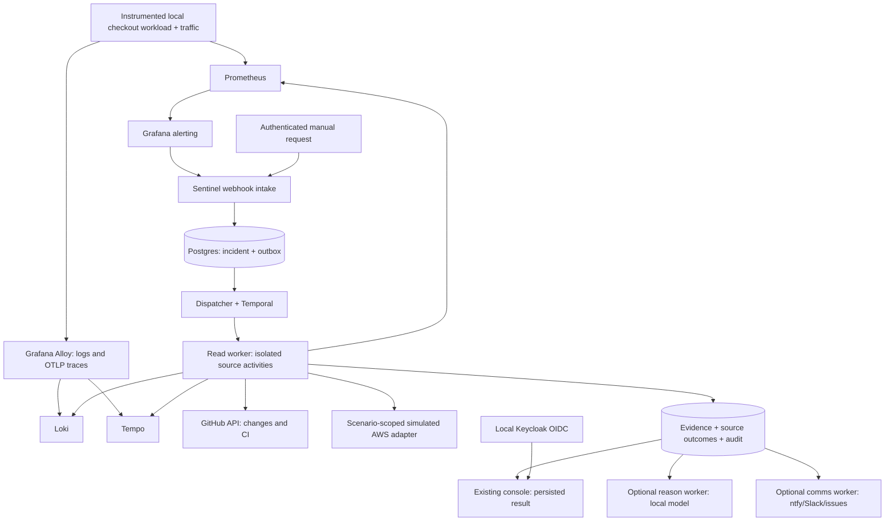

# Sentinel: real open-source integrations with explicitly simulated cloud context

Date: 2026-11-16. Research supplement to RESEARCH.md; preserves Cursor's original research and PLAN.md. This document updates architectural recommendations, not application code or the implementation plan. Sources were browsed and repository files inspected; no services were installed, external resources changed, or tests rerun for this research.

## A. Task, constraints and requirement corrections

The requested product remains the full Sentinel SRE platform. The current constraint changes how capabilities are demonstrated: actual telemetry, alerting, identity, storage and eligible connectors should operate against accessible systems; AWS and unavailable paid providers may be simulated, with explicit provenance. Frontend redesign is outside this research. A narrow read-only slice is a validation vehicle, not a redefinition of the complete product.

Research labels (new labels for this document, not existing PRD IDs): R1 real observability; R2 simulated AWS without credentials; R3 durable auditable investigations; R4 tenant isolation; R5 useful real free connectors; R6 future controlled remediation and broader SRE modules; R7 no UI redesign or implementation in this turn.

No docs/PRD.md exists. The ownership brief, original product overview and latest clarification are intent sources. No delivery deadline was supplied. Free means no required provider subscription for the recommended local environment, not zero compute/storage/maintenance cost. Existing hardware capacity is unmeasured. SaaS access, tenant installation permissions and network reachability cannot be assumed.

Corrections to Cursor's research:
- An AWS sandbox is no longer required to establish the real investigation path. Real local workload telemetry plus simulated cloud context meets the revised demonstration requirement.
- Grafana, Loki, Tempo, GitHub and communications must not all be postponed merely because AWS access is missing.
- Keep read-only first, but separate cloud changes from legitimate, authorized communication writes.
- Preserve current stack and uncommitted work. Working tree files already incorporate the showcase and PR #2's source changes, although branch ancestry still predates that merge. Do not infer file absence from HEAD ancestry alone.
- Do not blindly execute PLAN.md: its sandbox-first assumptions now need revision. This research does not revise that implementation plan.
- Missing/failed optional context is a partial investigation; missing critical SLI evidence is unknown/escalated, never healthy.
- Grafana OnCall OSS is archived; it is not a new foundation [S8].

## B. Verified repository findings and reusable boundaries

Inspected: root and console package manifests/lockfile; compose.durable.yml; packages/connectors/src/{index,slo}.ts; apps/worker-read/src/activities.ts; packages/workflows/src/index.ts; console Grafana webhook route; existing RESEARCH.md and PLAN.md. Previous conversation audits supply background, not new executed evidence.

Lockfile versions: Next 16.4.3, React 19.3.1, Temporal client/worker 1.25.0, pg 8.23.1, Vitest 5.0.5. Root permits Node >=22; existing CI uses Node 24. Keep lockfile versions as baseline rather than claiming README ranges identify installed versions. No applicable AGENTS.md found in the repository search.

Reusable foundation: Next route handlers, workspace access, Postgres transactions and RLS, append-only evidence/audit, outbox dispatcher, deterministic workflow identity, SLO collector, ECS reader, separate demo adapter and showcase. A connector manifest/catalog is metadata; it does not implement a provider API. GRAFANA_URL alone is not a Loki or Tempo connection.

Consequential gaps visible in code:
1. collectEvidence is one coarse activity; Prometheus failure prevents other reads. Existing evidence short-circuit also skips optional enrichment on retries. Per-source completion is needed.
2. Worker result exposes available:boolean, which cannot represent usable metrics + missing ECS, stale logs, or source-specific failures.
3. Query mapping requires one series per query and {window} templates; service label aggregation must match that contract. Latency units must match milliseconds. Data must be no more than two minutes old with limited future skew. The showcase's separate five-minute freshness rule is not the live collector's rule.
4. service_slos plus process-global PROMETHEUS_URL/workspace guard support one configured workspace, not general tenant connector configuration.
5. Grafana route expects x-sentinel-secret; payload delivery and header support must be checked against the pinned Grafana build. Alertmanager needs its own normalization contract, not a renamed Grafana endpoint.
6. The webhook deduplicates deliveries but this alone does not prove semantic incident deduplication across repeated notifications and multiple sources.
7. Temporal Compose uses start-dev with SQLite. Persisting its file makes local restarts durable; it does not make it a production server [S12].
8. Demo AWS placeholders are not authentication. Passkey proofs do not authorize execution. New generic evidence must not accidentally become trusted rollback evidence.

No new integration success, performance benchmark or test count is claimed here.

## C. Recommended architecture

This is a hybrid source environment, not a fake end-to-end workflow. HTTP requests to a running local workload produce real measurements; an intentionally broken workload is still a real measured experiment. Its environment is local/sandbox, not production. Invented ECS task states are simulated observations and must not be represented as measurements of that workload's hosting environment.

Grafana is the operator visualization and alerting surface; Sentinel queries Prometheus/Loki/Tempo directly for bounded evidence. Use one collector (Alloy) for logs and OTLP traces and Prometheus scraping for metrics. Do not deploy duplicate collectors and duplicate scraping paths without a reason. Grafana documents Alloy's collection capabilities [S4]; Loki and Tempo expose distinct query APIs [S5,S6].

Postgres owns incident state, connector references, immutable bounded evidence, source outcomes and delivery records. It is not a duplicate time-series or log database. Keep bulk telemetry in provider stores. Temporal owns durable coordination; activities own network I/O. Models own optional narrative generation. Only a separate, authorized comms worker may post externally; a future act worker remains absent/disabled.

Recommended contract direction, to be specified later: workspace/service/incident/run IDs; connector instance and capability; observed versus collected timestamps; query/window; config revision; provenance live/simulated; outcome ok/unavailable/stale/not-configured; reason and evidence references. This is an architectural requirement, not a finalized database schema.

Every conclusion records its supporting evidence IDs. A conclusion relying on simulated evidence is marked partly/fully simulated. Live SLI assessment may stand independently when supported only by live metrics. Simulation-only severity/recovery cannot close a live incident or satisfy action approval. No automatic live-to-mock fallback.

## D. Decisions and recommended answers to Cursor

### D1 — Existing application stack
Requirement R3/R4 -> retain TypeScript npm monorepo, Next routes, Postgres and Temporal. Evidence: implemented flow and locked dependencies above. Alternative: replace control plane with Python agent framework or fork an SRE product. Existing approach avoids replacing auth, data and workflows. Accepted tradeoff: multiple local processes. Assumption: no externally mandated API runtime. Verify by one full persistent investigation/restart test. Revisit for a separate external API requiring independent release lifecycle, not because Hono appears in the original wishlist.

### D2 — AWS boundary
R2 -> inject an explicit mock AWS connector per connector instance/scenario, using existing observation shape and strict fictional identifiers. Preserve live ECS adapter behind explicit configuration. Alternative: require live AWS or introduce LocalStack for all cloud services. Mock fits observed ECS reads with less infrastructure and no unverified emulator feature/tier dependence. Tradeoff: cannot prove IAM, AWS networking or actual rollback. Verify network-denied mock tests and provenance in stored results/exports. Revisit when authorized sandbox access exists; contract tests alone never certify AWS compatibility. LocalStack pricing/features require a separate check before selection [S19].

### D3 — Real telemetry source
R1 -> actual locally running instrumented service, request traffic and controlled faults; Prometheus + Grafana + Loki + Tempo. Alternative: static metrics fixtures or an entire observability platform rewrite. This produces inspectable evidence without AWS. Tradeoff: host resources and operating several services. Use the OpenTelemetry demo as an interoperability/reference workload, not a mandatory always-on full stack; its Compose documentation describes selectable deployment [S1]. Verify a fault changes provider measurements and the persisted investigation. Revisit if laptop resources cannot run the selected profile.

### D4 — Alert ownership
R1/R3 -> initially let Grafana evaluate configured SLO alerts and notify Sentinel using an authenticated contact point. Keep the incoming event and provider identity; do not regenerate the same incident from a parallel evaluator. Alternative: deploy Alertmanager immediately as another mandatory router. Alertmanager is valid where Prometheus rules already exist, but additional ownership now adds duplicate-event questions. Tradeoff: Grafana-managed alert config. Verify genuine firing/resolved deliveries, header compatibility, dedupe and response times. Add Alertmanager via its documented webhook configuration when required [S2,S3].

### D5 — Background work and partial completion
R3 -> source-specific activities with bounded deadlines, per-source outcome persistence, config snapshots and retry-safe writes. Keep the current outbox + Temporal. Alternative: expand one monolithic collector or add Redis/Kafka. Current implementation needs granular retries, not another queue. Tradeoff: more explicit source state. Authorization/invalid config should not be retried like transient HTTP 5xx. Temporal supports explicit retry policies; activities may retry and must handle side effects accordingly [S13]. Verify failure of ECS/Loki leaves valid metric evidence visible, and retry does not duplicate evidence. Never claim exactly-once remote writes.

### D6 — Tenant configuration and secrets without AWS
R4/R5 -> connector instances scoped to workspace/service with capability-specific endpoint/config and opaque secret references. For local deployment, references resolve only against operator-managed local secret files/mounts; no arbitrary browser path access. Future deployment can swap in a vault or Secrets Manager resolver. Alternative: process-global tokens or embedding AWS Secrets Manager now. Accept local operator burden; do not pretend this is complete multi-tenant secret management. Restrict endpoint egress, redirects, private-network destinations and response sizes according to explicitly allowed local services to prevent SSRF. Verify two workspaces cannot select or resolve each other's references. Revisit for multi-host hosted deployment/key rotation requirements.

### D7 — Identity
R4 -> keep existing OIDC client; use a dedicated local Keycloak realm/client. Alternative: Authentik, hosted trial or auth bypass. Keycloak gives an independent issuer without company access. Tradeoff: another container and browser/container issuer networking must be correct. Verify discovery issuer matches, callback, logout/session revocation, cross-workspace denial and passkeys. Current workspaceAccess returns 404 for non-members: test denial, not a hardcoded expectation of 403. start-dev is local-only [S11].

### D8 — Free communication versus full paging
R5 -> self-hosted ntfy as first real notification endpoint; optional Slack webhook in a team-approved workspace, plus GitHub Issues if authorized. Alternative: require paid paging suites. These deliver real notifications with limited scope; they do not implement a complete on-call scheduling product. Tradeoff: channel-specific permissions/retention. Slack free workspaces impose app limits [S15]; webhook URLs are secrets and posting requires explicit setup [S16]. Provider timeouts can leave delivery ambiguous; ledger + idempotency/reconciliation is required, not blind unlimited retries. Verify recipient receipt. No messages were sent in this research.

### D9 — AI
R6 -> deterministic measurements/ranking remain the floor; optional Ollama local model summarizes evidence and cites IDs, with abstention and timeout fallback. Alternative: mandatory Bedrock or claiming a template is AI. Local inference avoids a required model API subscription [S17], but hardware, model quality and weights license are unverified. Tradeoff: latency/memory and weaker results may be unacceptable. No model receives production write tools or secret values. Verify factuality, prompt injection handling, evidence coverage, missing-data refusal and measured latency. Revisit provider choice after evaluation; no particular model is endorsed without testing.

### D10 — Broader product modules
R6 -> keep original requirements but separate what can be real locally from simulated/provider-dependent capabilities. Real GitHub changes/CI, SLO reporting, incident notes/postmortem drafts and local endpoint health can be built on the same evidence store. Real cost/DR/quotas of AWS cannot be inferred from fictional observations; those remain explicitly simulated. Local k3d can support actual Kubernetes experiments [S24], not actual EKS verification. Alternative: simulate the entire product or silently delete modules. Accepted tradeoff: uneven capability maturity clearly documented. Verify each capability against its real provider; revisit when specific external systems become accessible.

## E. Connector selection: real, conditional, simulated and deferred

These are recommendations, not already-working integrations.

| Connector/capability | Recommended mode | Data path and constraints |
|---|---|---|
| Prometheus | Real/self-hosted | Existing query adapter; real service counters/histograms; no subscription |
| Grafana OSS alerting | Real/self-hosted | Existing webhook intake plus contact point/rule configuration; actual delivery required |
| Loki | Real/self-hosted | Bounded LogQL query_range; independent base URL and auth; redact sensitive logs [S5] |
| Tempo | Real/self-hosted | Trace search and trace retrieval; stable documented endpoints; partial trace awareness [S6] |
| Alloy/OTel | Real collection | Telemetry collection, not a storage database or substitute for a Sentinel query connector [S4] |
| GitHub commits/deployments/CI | Real/conditional | Existing read adapter expanded with scoped repo access, pagination/rate limits and incremental reconciliation [S9,S10] |
| Alertmanager | Real when selected | Own payload normalization, routing/dedupe; not mandatory alongside Grafana [S3] |
| Blackbox exporter | Real/self-hosted | HTTP/TLS probes via Prometheus; constrain target allowlist [S20] |
| node_exporter | Real/optional | Host metrics; Docker-on-Mac may expose VM/container rather than laptop host [S21] |
| Keycloak | Real/self-hosted | Dedicated local identity, no company provider [S11] |
| ntfy | Real/self-hosted | Explicitly authorized notifications [S14] |
| Slack | Real/conditional | Installation permission and plan limits; webhook posting is not full Slack bot functionality [S15,S16] |
| GitHub Issues | Real/conditional write | Separate communication authority; never merge PRs or modify source automatically |
| SLO rules | Real/optional | Study Sloth or Pyrra generation; choose one source of truth, not both controllers [S22,S23] |
| Status/uptime | Real/optional | Gatus supplies independent checks/status; avoid duplicating Sentinel incident ownership [S18] |
| Local Kubernetes | Real/optional | k3d when Kubernetes is needed; no requirement to move Sentinel itself to Kubernetes [S24] |
| AWS ECS/CloudWatch/cost/DR | Simulated now | Adapter-specific fictional observations; no live AWS claims |
| Datadog/New Relic/PagerDuty/Jira/Teams etc. | Conditional or simulated/unconfigured | Existing account entitlement might permit live API access; do not assume all are paid or all are free |
| Bedrock | Deferred/simulated provider | Use optional local inference for actual AI; do not describe template output as Bedrock |

No claim that every named connector can be connected without accounts or endpoint access. Distinguish free software from SaaS free tiers, enterprise feature licensing and deployment costs. Provider API keys and team permissions remain prerequisites.

## F. Open-source implementations worth studying

- Prometheus [S25] and Grafana [S26]: standards and operator ecosystem, not code to copy into Sentinel. Keep product data ownership in Sentinel.
- HolmesGPT [S27]: investigate toolset/evidence workflows and evaluate as a later isolated read-only specialist. It introduces a separate runtime/provider concerns; do not replace the working control plane simply to get an agent label.
- Robusta Classic [S28]: concrete Kubernetes/Prometheus alert enrichment patterns. Kubernetes focus is a limitation for this AWS-simulated, initially Compose-based system; do not install its remediation behavior indiscriminately.
- SigNoz [S29]: strongest coherent alternative telemetry backend: OTel-oriented unified signals. Not recommended in addition to the Grafana stack because that duplicates storage/operations. Reconsider if a measured Grafana stack integration cost/resource footprint is worse. Review feature-level license boundaries before embedding code; a repo being visible is not a universal license grant.
- OpenTelemetry demo [S1]: reference for real instrumentation and controlled experiment workloads. Full demo is optional, not a minimal laptop requirement.
- OpenStatus [S30], Gatus [S18]: status/incident concepts and bounded health checks. Current request excludes visual redesign; no CSS/component copying recommended. OpenStatus lists AGPL; preserve license obligations if reusing source.
- Sloth/Pyrra [S22,S23]: avoid inventing every SLO recording rule. Still test parity with Sentinel severity and units.
- Keep candidate repository returned 404 during this research; no availability or license recommendation is based on it. This is unresolved evidence, not proof the project is discontinued.

Downloading more skills does not connect providers or certify architecture. Existing docs/testing skills are sufficient for later work; use provider docs and contract tests for connectors. No new skill downloads are recommended in this backend-focused research.

## G. Ranked risks and verification implications

| Priority / uncertainty | Smallest proposed check | Evidence expected / response if failed |
|---|---|---|
| 1: real fault reaches actual investigation | Local workload errors -> Prometheus -> Grafana webhook -> Temporal -> Postgres; inspect incident evidence independently | Current observed values and persisted provenance; repair network/query/header configuration before adding providers |
| 2: live+simulated evidence contaminates conclusions | Real metrics + simulated bad ECS deployment; inspect exports, narrative and recovery | Cloud conclusion labelled simulated, no trusted action/closure; block action consumption if mixed provenance is lost |
| 3: source failure/retry loses evidence | Fail Loki/ECS while metrics succeed, retry and restart worker | Persisted partial outcome, no invented samples or duplicate observations; split activities if coarse retries fail |
| 4: SLI/query semantics | Real multi-series metrics and histogram seconds, insufficient history and no traffic | Aggregation to one service series, ms conversion, defined cold-start/unknown behavior; no fake backfilled live data |
| 5: tenant/endpoint abuse | Cross-workspace references, localhost/admin URL, redirects, DNS/private targets | Denied except explicitly configured local provider endpoints; enforce server-side endpoint policy |
| 6: machine resources | Measure selected services under traffic with bounded telemetry retention | Actual CPU/RAM/storage and delay, not guessed capacities; reduce optional profiles/workload before replacing stack |
| 7: provider permission/network | Scoped GitHub read and approved Slack/ntfy test; browser/container OIDC discovery | Actual records and recipient receipt; mark unconfigured if permission missing, never fake successful auth |
| 8: notification ambiguity | Provider receives then times out before acknowledgment | Delivery marked ambiguous and reconciled; do not promise exactly-once Slack posts |

All checks above are proposed, not executed in this research. Unit/mock tests prove parsing, decisions and retries under controlled responses. Real provider tests prove actual auth/payload/reachability. A successful /health endpoint alone proves neither data freshness nor correct service mapping. Browser passkey success and virtual authenticator CI test different boundaries. Deployment readiness needs persistence/restore, restart and operational checks beyond typecheck/build.

Realtime here means near-real-time with visible timestamps and measured latency: scraping, alert pending/evaluation, queues and API calls introduce delay. Proposed local target: 15-second scrape and 15–30-second evaluation, then measured investigation delay; this is a configuration recommendation, not a benchmark or guaranteed SLA. The 6-hour SLO window requires an explicit data-coverage policy; querying a range is not proof that six hours of samples exist. Do not fabricate historical data as live measurements.

## H. Questions, readiness and discussion

No technical selection question requires the owner to choose between libraries now. Recommended defaults: locally hosted free services, minimal instrumented workload, one test workspace, explicit simulated cloud context, preserved original product scope. Hardware feasibility is still provisional; inspect available resources before promising the entire stack can run together. Shared SaaS workspace installation/posting requires its owner's permission when implementation reaches that action.

Three decisions the owner should understand:
1. Real local telemetry is acceptable evidence about a local test service; simulated AWS does not validate AWS. Default: accept this hybrid environment.
2. Self-hosted OSS avoids mandatory subscriptions but requires compute and maintenance. Default: local Compose with optional heavyweight profiles.
3. AI is optional narration over measured evidence, not authority. Default: deterministic baseline, optional local model only after evaluation.

Ready for specification/planning with stated assumptions. Highest-risk first validation is the real alert-to-persisted-evidence path with mixed-source provenance, not an AWS login. Paid providers, full multi-account AWS, cloud remediation, large specialist runtimes and mobile are sensible later capabilities; the original brief retains them. Actual implementation order and task breakdown belong to the subsequent plan, not this document.

Likely discussion questions:
- Why keep Temporal? Existing durable/retry path is reusable; accept operational overhead. Change if durable workflows are removed from requirements.
- Is local telemetry real? Measurements of running requests are real, but environment is local. Change claims only after actual production verification.
- Why direct provider reads? Prometheus/Loki/Tempo have signal-specific APIs; Grafana supplies alerting/visualization. Reconsider if deployment policy permits access only through a Grafana proxy.
- What happens when one connector fails? Preserve usable evidence, record missing source, escalate if required SLI is unavailable. Change required/optional policy by service, not by hiding errors.
- Why no LocalStack dependency? Current read observations can be simulated at the adapter boundary; emulator compatibility and tiers are separate questions. Revisit for actual AWS SDK integration tests requiring supported emulated APIs.
- Can we claim complete product? Only per-capability acceptance evidence supports that; catalogue rows and a successful simulated workflow do not establish the full backlog.

## Primary source index

Sources checked 2026-11-16. Latest documentation is evidence of documented capability, not proof of compatibility with unpinned future images. Pin exact provider images/API versions during specification and verify the selected combination.

- S1: https://opentelemetry.io/docs/demo/docker-deployment/
- S2: https://grafana.com/docs/grafana/latest/alerting/configure-notifications/manage-contact-points/integrations/webhook-notifier/
- S3: https://prometheus.io/docs/alerting/latest/configuration/
- S4: https://grafana.com/docs/alloy/latest/introduction/how-alloy-works/
- S5: https://grafana.com/docs/loki/latest/reference/loki-http-api/
- S6: https://grafana.com/docs/tempo/latest/api_docs/
- S7: https://grafana.com/docs/loki/latest/send-data/promtail/ — deprecated collector; prefer Alloy for new setup.
- S8: https://grafana.com/docs/oncall/latest/intro/ — archived 2026-03-24.
- S9: https://docs.github.com/en/rest/using-the-rest-api/rate-limits-for-the-rest-api
- S10: https://docs.github.com/en/webhooks/using-webhooks/handling-failed-webhook-deliveries — failed deliveries are not automatically redelivered; reconciliation matters.
- S11: https://www.keycloak.org/server/containers
- S12: https://docs.temporal.io/self-hosted-guide
- S13: https://github.com/temporalio/documentation/blob/main/docs/develop/typescript/activities/timeouts.mdx — also retrieved through Context7 /temporalio/documentation.
- S14: https://docs.ntfy.sh/publish/
- S15: https://slack.com/help/articles/27204752526611-Feature-limitations-on-the-free-version-of-Slack
- S16: https://docs.slack.dev/messaging/sending-messages-using-incoming-webhooks/
- S17: https://docs.ollama.com/api/introduction
- S18: https://github.com/TwiN/gatus
- S19: https://www.localstack.cloud/pricing — no claim of free ECS emulator support made.
- S20: https://github.com/prometheus/blackbox_exporter
- S21: https://github.com/prometheus/node_exporter
- S22: https://github.com/slok/sloth
- S23: https://github.com/prometheus-community/pyrra
- S24: https://github.com/k3d-io/k3d
- S25: https://github.com/prometheus/prometheus
- S26: https://github.com/grafana/grafana
- S27: https://github.com/HolmesGPT/holmesgpt
- S28: https://github.com/robusta-dev/robusta
- S29: https://github.com/signoz/signoz
- S30: https://github.com/openstatusHQ/openstatus
